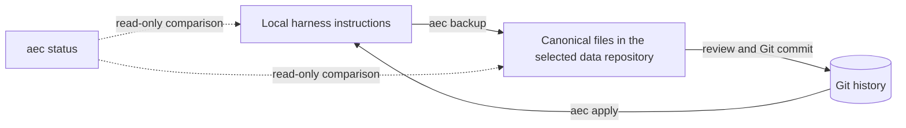
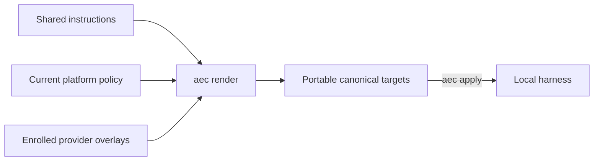
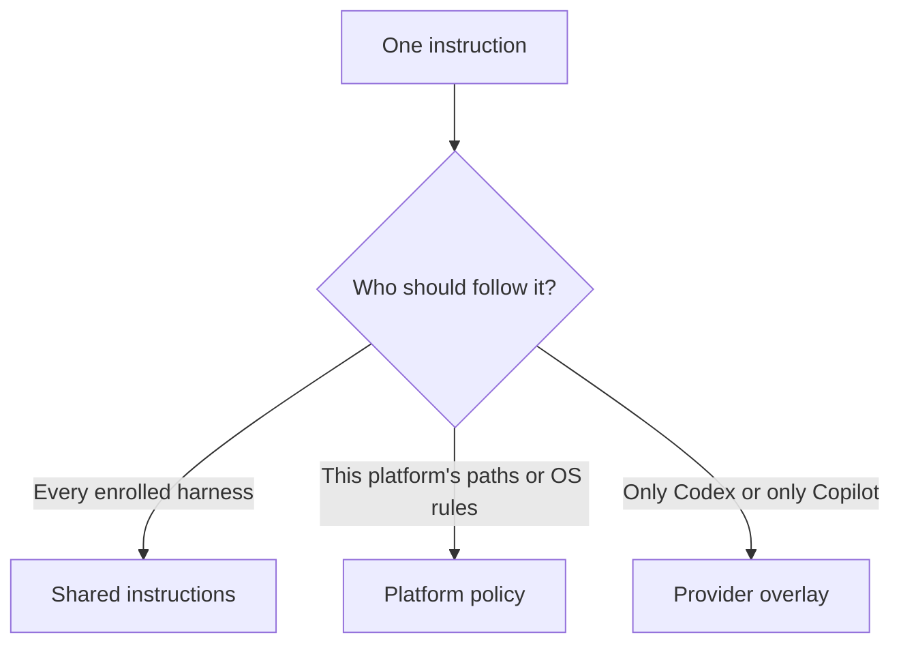

# AI Environment as Code

Version your AI environment with explicit control.

AEC is a local .NET CLI that keeps selected AI-harness instructions in an
explicitly chosen Git data repository. Git history is the source of truth.
Ordinary AEC commands do not fetch or push. The explicit `migrate` command
may fetch and fast-forward its tracked default branch. It never pushes.
Bundled skills can coordinate remote checks and an explicitly approved push
without depending on GitHub or GitLab.

## How it works today



`backup` captures runtime changes and creates its approved commit. `apply`
deploys committed repository content to runtime. `status` only inspects drift.
The commands have separate directions; there is no automatic `sync`.

Portable targets combine instructions for a platform and provider:



`render` changes neither runtime nor Git history. `init --enroll-shared`
creates one target from reviewed, committed sources without deploying or
committing it. Codex and Copilot `status` and `apply` use enrolled committed
targets; `backup` can attribute a changed instruction section to its source.
See the [backup reference](docs/reference.md#backup) for provider-specific details.
Ordinary provider `init` retains its provider-specific flow.

See the [architecture diagrams](docs/architecture.md) for current component
boundaries and class relationships, and the [glossary](docs/reference.md#glossary)
for capture, preflight, target, preview and fixture.

## Where should an instruction go?



For example, “ask before committing” is shared; local paths are platform
policy; a Codex model choice belongs to its overlay. AEC does not classify
existing instructions for you. Review and commit all three sources:

```text
environment/shared/instructions.md
environment/platforms/<current-platform>/policy.md
environment/providers/<selected-provider>/overlay.md
```

After ordinary initialization, run `aec init --repo ABSOLUTE_PATH --enroll-shared`
for Codex, or add `--provider=copilot`. Review and separately commit the new
target; enrollment does not deploy it.

For an existing 1.x repository, the explicitly authorized
`aec migrate 2.0 --repo ABSOLUTE_PATH` prepares sources, waits for exact `DONE`,
commits targets, applies enrolled providers and verifies status. Close affected
harness sessions and pause other writers throughout migration. Review the
[migration guide](docs/migration.md#interactive-migration-command) and
rehearse with disposable copies before live use.

## Start on Apple-silicon macOS

You need Git, the .NET 10 SDK, and Xcode Command Line Tools to build. From this
repository, build and install the self-contained executable for your user:

```sh
./scripts/build-osx-arm64.sh
./scripts/install-osx-arm64.sh
aec version
```

The default executable location is `$HOME/.local/bin/aec`; it must be on the
`PATH` inherited by the local harness. The installer does not use `sudo` or
change your shell profile. Then select an absolute path for an empty data
repository and initialize Codex:

```sh
aec init --repo /absolute/path/to/aec-data
```

Complete the authored-source and target enrollment steps above before using
portable `status`, `backup`, or `apply`. Review changes and history before
pushing. Without a remote, AEC stays local; the skill will not choose one for you.
For clones, the skill checks the tracked remote and default branch before a
canonical change or runtime apply. See the [two-checkout workflow](docs/reference.md#sharing-migrated-instructions-between-machines)
and [detailed reference](docs/reference.md) for other providers, paths and installation options.

Ordinary init checks that the implicit Codex and Copilot homes select the same
repository. Custom-home flags are not covered by that check: use the same
`--repo` checkout for both harnesses yourself.

## What has been verified

| Local harness | macOS ARM64 | Windows x64 | Linux ARM64 |
|---|---|---|---|
| Codex | ✓ Historical real-harness checkpoint | ⚠ Not real-harness verified | ⚠ Not real-harness verified |
| GitHub Copilot | ⚠ Alpha; not real-harness verified | ⚠ Alpha; not real-harness verified | ⚠ Alpha; not real-harness verified |
| Claude and Gemini | ⚠ Not implemented | ⚠ Not implemented | ⚠ Not implemented |

Current 2.0 Codex and Copilot real-harness verification is deferred to
[#4](https://github.com/ferrywlto/ai-env-as-code/issues/4). The historical
checkpoint and isolated tests do not establish it. See [verification details
and historical runs](docs/reference.md#local-harness-verification).

## Read more

- [Shared-instruction design](docs/shared-instructions-design.md): ownership,
  enrollment, rendering, and safe directional flows.
- [Detailed reference](docs/reference.md): commands, workflows and release history.
- [Migration guide](docs/migration.md): migration steps and safety requirements.
- [Build and test guide](docs/development.md): platform builds, tests and troubleshooting.
- [Implementation checklist](IMPLEMENTATION_CHECKLIST.md): completed increments
  and the immediate next work.
- [Landing page](docs/index.html).

AEC is licensed under [AGPL-3.0](LICENSE). If it helps you, please consider
citing [@ferrywlto](https://github.com/ferrywlto) or
[buying me a coffee](https://www.paypal.com/paypalme/ferrywlto). ☕️
