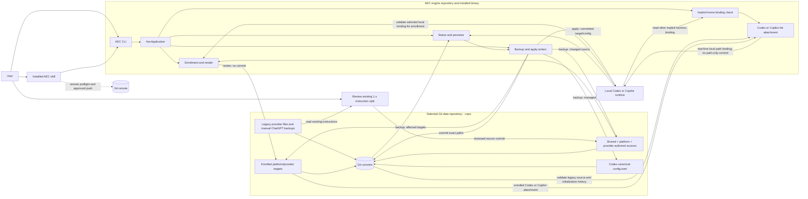
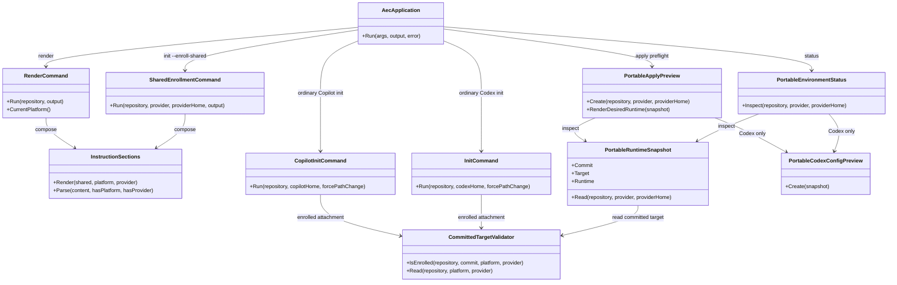
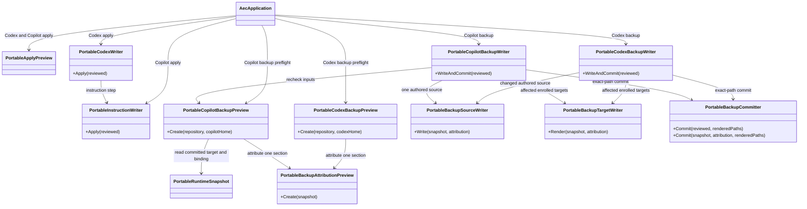

# AEC architecture (2.0 development branch)

This is the **current implementation**, not a target-state design. The engine,
the selected `--repo` data repository, and each local harness runtime are
separate. Git commits in the data repository are the source of truth. The
class diagrams show the main relationships, not every implementation helper.

## Components

`aec render` composes only already-enrolled targets for the current platform;
`aec init --enroll-shared` enrolls one selected provider. Neither commits nor
deploys. `status` reads, `backup` moves runtime changes into the repository and
commits, and `apply` moves committed repository content into runtime. The CLI
does not fetch or push; the installed skill coordinates remote checks and any
approved Git operations. Codex also manages root `personality` in
`config.toml`; Copilot currently manages only its instruction file.
Confirmed Codex or Copilot attachment of a clone at a new local path changes
only its runtime binding; it does not commit a machine-specific path to shared
history. Copilot requires a clean committed canonical source for this rebind.
Enrollment then trusts that local binding, while still validating committed
canonical content and history; the canonical block may name the original
machine's checkout path. Ordinary Codex and Copilot init validate a committed,
current-platform target when enrolled and compose a local portable control
block from it. Historical canonical files stay unchanged. Once a local runtime
has a portable block bound to this checkout, repeating init without the flag
does not rewrite instructions; Codex also preserves config. Status/apply own
later drift.
Ordinary init checks the other harness's implicit home before writes and stops
on a different repository binding. Explicit custom homes are outside that
cross-harness check in this 2.0 alpha slice.
The [existing-user migration](reference.md#migrating-an-existing-1x-repository-to-20)
uses a reviewed split followed by per-provider enrollment, target commits, and
approved apply. Classification is a user/skill review step; the engine does not
guess it or delete the historical provider files and manual backups.

## Classes: source composition and runtime inspection

The snapshot binds a committed target to the current platform, selected data
repository, and local runtime control block. It is the common read boundary;
previews plan changes but do not authorize writes without revalidation.

## Classes: directional writes

The Codex backup writer rechecks runtime inputs and Git state before replacing
canonical files, then commits only the affected paths. An interrupted
multi-file write can leave partial uncommitted changes, so it reports the need
to inspect rather than rolling back automatically. Copilot `status` and
`apply` use the portable target. Public Copilot `backup` now uses the same
snapshot and one-section attribution rules. Its writer rechecks the preview,
refuses pre-existing staged changes, and commits one attributed source plus
affected targets. The retained 1.x Copilot backup helper is not routed from
the public command.
