# AEC architecture (2.0 development branch)

This is the **current implementation**, not a target-state design. The engine,
the selected `--repo` data repository, and each local harness runtime are
separate. Git commits in the data repository are the source of truth. The
class diagrams show the main relationships, not every implementation helper.
See the [glossary](reference.md#glossary) for capture, preflight, target, preview
and fixture, including the distinction between rendered targets and target versions.

## Components

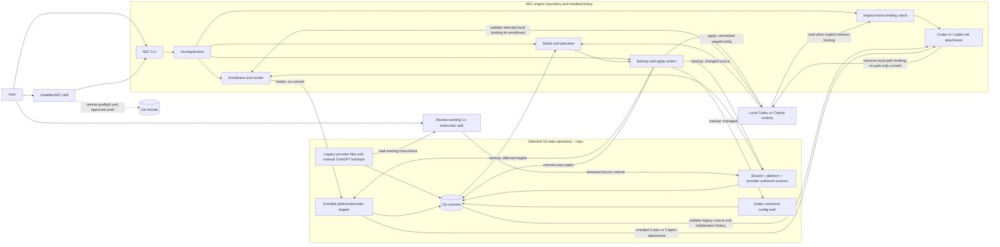

`aec render` composes only already-enrolled targets for the current platform;
`aec init --enroll-shared` enrolls one selected provider. Neither commits nor
deploys. `status` reads, `backup` moves runtime changes into the repository and
commits, and `apply` moves committed repository content into runtime. The CLI
does not fetch or push; the installed skill coordinates remote checks and any
approved Git operations. Codex also manages root `personality` in
`config.toml`; Copilot currently manages only its instruction file.
Confirmed Codex or Copilot attachment of a clone at a new local path changes
only its runtime binding; it does not commit a machine-specific path to shared
history. Copilot requires a clean committed canonical source for this rebind.
Enrollment then trusts that local binding, while still validating committed
canonical content and history; the canonical block may name the original
machine's checkout path. Ordinary Codex and Copilot init validate a committed,
current-platform target when enrolled and compose a local portable control
block from it. Historical canonical files stay unchanged. Once a local runtime
has a portable block bound to this checkout, repeating init without the flag
does not rewrite instructions; Codex also preserves config. Status/apply own
later drift.
Ordinary init checks the other harness's implicit home before writes and stops
on a different repository binding. Explicit custom homes are outside that
cross-harness check in this 2.0 alpha slice.
The [existing-user migration](reference.md#existing-manual-migration--implemented-and-rehearsed)
uses a reviewed split followed by per-provider enrollment, target commits, and
approved apply. Classification is a user/skill review step; the engine does not
guess it or delete the historical provider files and manual backups.
The [planned interactive migration](reference.md#interactive-migration-command)
adds an explicitly scoped fast-forward pull and legacy-compatible capture before
scaffolding, then waits for `DONE` before source commits and enrollment/render/apply.
It is not implemented or represented as a current component above; ordinary CLI
commands retain their no-network boundaries. An incomplete invocation restarts
from preflight, with an explicit Preserve/Overwrite choice for dirty section files.

### Migration concurrency contract

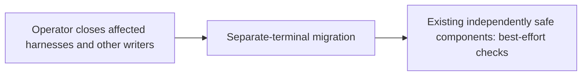

The top-level migration entry point must warn once before its first mutation;
it does not detect or terminate processes. Keep the selected data checkout and
managed runtime configurations free of other writers until migration finishes,
including the `DONE` editing pause. Use a plain editor, not the affected harness.
This is an operating precondition, not proof of exclusive access or atomicity.
Warning emission belongs to the planned public flow, not to each component.
See the [operating precondition](reference.md#migration-operating-precondition).

Keep current component safeguards unchanged. After the functional migration
flow is complete, schedule a separately approved refactor to assign clear check
ownership and consolidate overlapping full-context validation. Preserve existing
contracts/tests and the checks at review, actual mutation, staged-content and
committed-result boundaries; do not build a generic transaction framework.

## Internal migration preflight — no CLI dispatch yet

```mermaid
flowchart LR
    Input["Repository + target format"] --> Preflight[MigrationPreflight.Read]
    Preflight --> History["InitCommand: contained Git metadata<br/>and original initialization history"]
    Preflight --> Marker["ApplyCommand: committed .aec-version<br/>with exact working/index provenance"]
    History --> Legacy["No marker: validate current legacy files<br/>then recognize format 1.0"]
    Marker --> Versions["Validate forward known path<br/>and binary major/minor capability"]
    Legacy --> Versions
    Versions --> Snapshot["Return pinned commit + formats<br/>No writes or network"]
    Snapshot --> Selection[MigrationHarnessSelection.Read]
    Selection --> Homes["AecApplication implicit home resolvers<br/>CODEX_HOME / COPILOT_HOME or profile defaults"]
    Homes --> Runtime{"Local instruction file exists?"}
    Runtime -->|No| Skip["Skip provider; no repository-folder inference"]
    Runtime -->|Yes| Bindings["Codex/Copilot full-block parsers<br/>Require selected checkout and current platform"]
    Bindings --> Selected["MigrationHarness: provider, home, runtime path<br/>Recheck pinned HEAD; no writes"]
```

This helper reuses the original initialization proof without init's clean-tree
or `main` requirement. Draft sections do not imply completion. Dirty-section and
remote preflights below are separate internal stages, not a public orchestrator.
The selector validates local runtime enrollment, not harness installation:
an existing unbound/malformed file or conflicting checkout/platform stops selection.
Recognized portable blocks remain selected for incomplete-migration retries; they
do not prove repository completion or legacy-capture readiness. All-absent homes/files
return an empty selection, never implicit enrollment from repository data.
The Git-tracked format marker denotes completed data migration, not the CLI or
managed-block version. There is no marker writer or public `migrate` route yet.

### Internal dirty-section decision

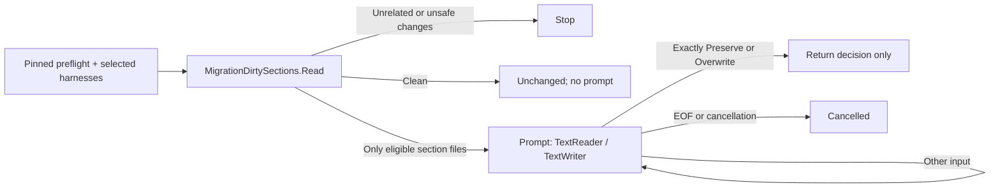

Eligible paths are the shared instructions, current-platform policy, and selected
provider overlays—not whole directories. Git status uses NUL records and disables
optional index writes; committed/indexed kinds, links and ignored sections are
checked separately. Renames, copies, conflicts, type changes, and other dirty paths
stop before the prompt. No choice writes or discards content. Later preparation
must revalidate HEAD and paths before acting; this is not a saved authorization.

### Internal remote preflight

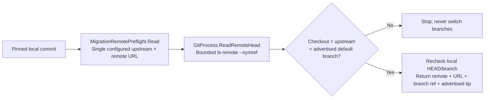

Missing/ambiguous tracking, local-only remotes, unresolved remote HEAD, detached or
non-default checkouts, transport failures and timeouts stop. The query disables Git
terminal prompting and closes child stdin; its 30-second budget includes startup,
with up to one second to confirm Git exit after timeout termination. Transport
stderr is not echoed because it may contain credentials. No fetch, pull, checkout
or ref update occurs. An advertised tip alone proves no ancestry; future pull work
must revalidate before acting. Tests use local bare remotes, not hosted SSH/HTTPS
or real-harness integration.

### Internal fetch preparation

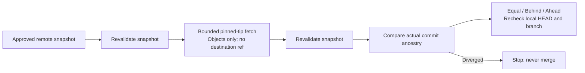

`MigrationFetchPreparation` compares remote name, configured URL, default branch
and advertised tip before and after fetching. The URL stays in memory and is not
echoed in errors. Fetch has a two-minute budget plus up to one second for timeout
cleanup. An empty refmap and explicit no-tags/no-submodules/no-FETCH_HEAD options
prevent configured fetch mappings from changing refs or tracking metadata.
Ancestry checks ignore replacement refs and use the fetched commit, not stale
tracking refs. Received objects may remain after a later stop; HEAD, refs, index,
authored files and runtime must remain unchanged. The result is advisory: future
fast-forward execution must revalidate again. No public migration route, pull,
merge, push or worktree advancement is added. Disposable local-remotes tests do
not prove SSH/HTTPS or real-harness integration.

### Internal clean-checkout advancement

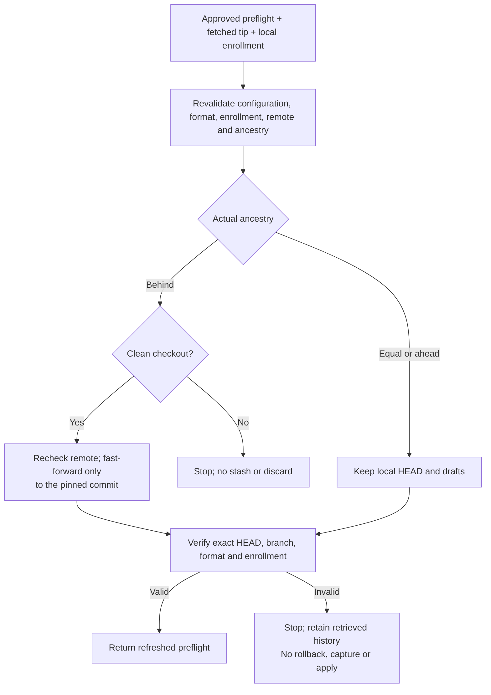

`MigrationFastForward.Execute` is internal, not a public `migrate` command.
It reuses the fetch helper's replacement-ref-free ancestry check, but performs
no fetch itself. Only a behind, clean checkout may move: no merge commit, branch
switch, reset, autostash, push or runtime write. Dirty-section integration remains
a later slice. Ignored-file collisions abort rather than being overwritten.
Per-command Git settings disable hooks, recursive submodule updates, automatic
line-ending conversion and branch merge defaults without modifying user config.
Git documents [per-command hook disabling](https://git-scm.com/docs/git-config#Documentation/git-config.txt-corehooksPath)
and [ignored-file collision refusal](https://git-scm.com/docs/git-merge#Documentation/git-merge.txt---no-overwrite-ignore).
Configured external clean/smudge/process filters and enabled/custom fsmonitor
stop before validation or advancement; this conservative boundary avoids invoking
checkout tools automatically. It is not a sandbox for arbitrary Git transports or
concurrent hostile changes. After advancement, failure retains the actual checkout
and reports that inspection is needed; no destructive rollback is attempted.
Native platform and real-harness verification remain separate from local fixtures.

### Internal preparation composition

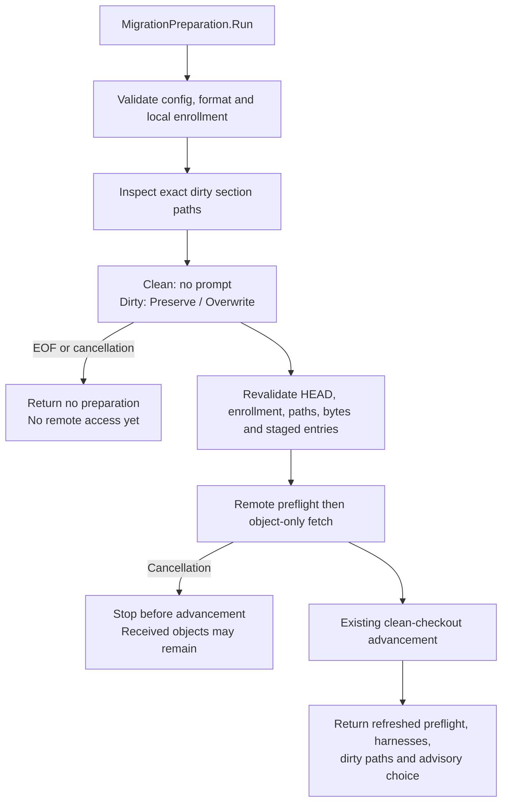

The coordinator reuses the existing helpers; it does not route a public command.
Pre-requested cancellation skips all inspection. EOF/cancellation at the dirty
prompt stops before querying a remote; cancellation is checked between bounded
remote operations and immediately before fast-forwarding. It does not interrupt
an already running Git operation. Once HEAD has advanced, cancellation cannot
return a misleading empty result: completed preparation or retained-history
validation failure reports the actual outcome. Behind plus dirty still stops,
even with Overwrite; equal/ahead retain drafts. Prompt-time byte or staging changes
invalidate the choice before remote access. Returned choices authorize no writes;
later capture/scaffolding must freshly validate their inputs. No backup, section
generation, source/target commit, render, apply, version marker or push is added.

### Internal legacy-capture preview

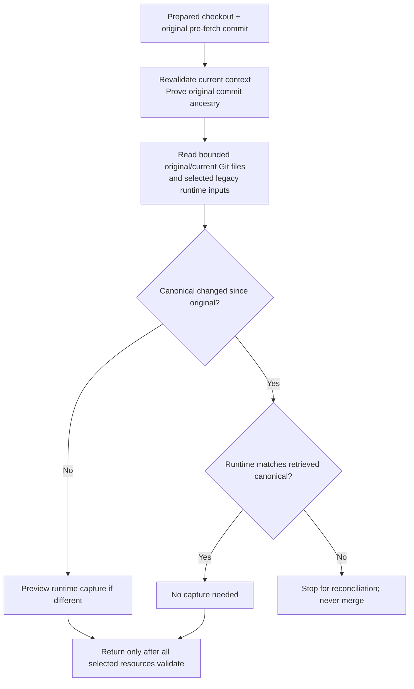

Preparation retains `OriginalCommit` separately from its refreshed HEAD.
`MigrationLegacyCapturePreview.Read` validates current format/enrollment and
dirty-path scope, then checks original-to-current ancestry without replacement
refs. Historical files require one exact regular-blob tree entry and a size check
before raw reading. Current files also require clean index/worktree provenance
and exact equality with the real Git blob. Instruction decisions compare bytes;
Codex config compares only the managed personality enum and preserves retrieved
canonical formatting with the existing config updater. Unrelated runtime TOML
settings never enter proposed canonical bytes. Missing/invalid personality stops,
without adding defaults. Only selected legacy providers are read; portable runtime
blocks use the separate portable preview/handoff below, never legacy whole-file copying.
Canonical legacy blocks may name another machine's checkout; local runtime must
bind to this checkout. Results are advisory byte proposals, not write authority.
No remote query, write, staging, commit, scaffolding, render or apply occurs.

### Internal legacy-capture writer

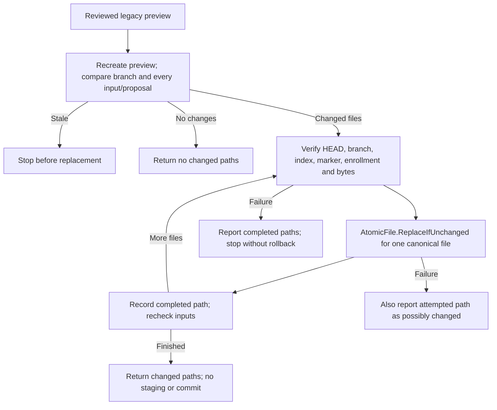

`MigrationLegacyCaptureWriter.Write` uses freshly derived proposals, not mutable
buffers supplied by the reviewer. The preview now pins its symbolic branch, so
a same-HEAD branch switch still invalidates review. The writer pins the raw index
and verifies that the legacy format marker remains absent around every replacement.
Already-written canonical files must match their proposed bytes; remaining files
must match their original bytes, and all selected runtime bytes stay unchanged.
Existing guarded atomic replacement preserves file mode and checks the destination.
Atomicity is per file, not across the batch. `MigrationLegacyCaptureWriteException`
reports completed paths plus any attempted path that may have changed before an
error was detected. Earlier replacements remain inspectable; there is no rollback.
Authored drafts, runtime, unrelated config, unselected providers, HEAD and index
are not written. No commit, stage, remote operation, scaffolding or public command
is added; committing these working-file changes is a later boundary.

The deterministic failure fixture uses an unwritable destination directory on
Unix (normal non-root execution) or a non-delete-sharing file handle on Windows.
Unix root may bypass that permission restriction; native platform proof remains
separate from the current local managed-code run.

### Internal legacy-capture write and commit

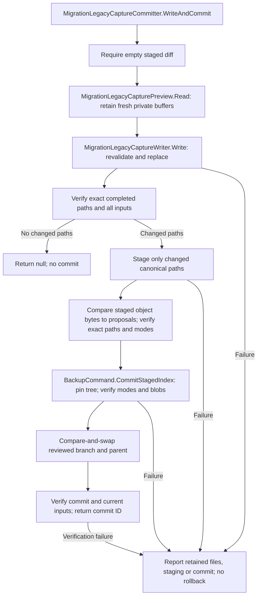

The coordinator owns writing and committing; it does not accept already-written
paths from callers. Private fresh buffers bind staged Git object bytes directly
to the proposal. The shared commit helper optionally verifies expected modes in
its pinned tree before publishing; existing callers retain their prior contract.
HEAD, symbolic branch, enrollment, absent format marker and every selected
canonical/runtime file are rechecked around staging and after commit. A preexisting
staged diff stops before writing; unstaged authored drafts stay out of the commit.
No-op still validates the reviewed snapshot. This is not a transaction or lock:
later failure may retain working changes, staging or a new commit for inspection.
No rollback, push, scaffolding, render/apply, public route or runtime write is added.

### Internal portable-capture preview for interrupted migration

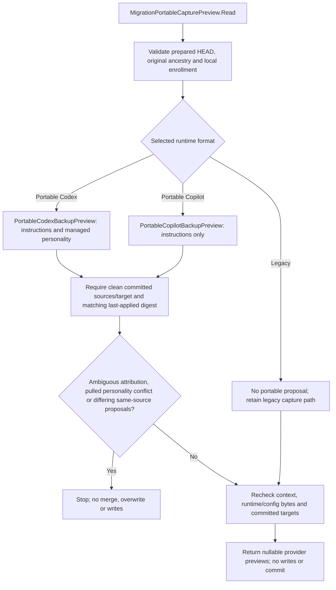

The completion marker may still be absent after a prior migration applied one
provider. Section-aware backup previews handle that portable runtime; generated
instructions are never proposed as a legacy whole-file capture. A null provider
preview means absent or legacy; an unchanged portable provider retains its preview.
Historical regular-blob reads ignore replacement refs and reuse the legacy
preview's bounded reader and original-ancestry check. All selected runtime bytes,
including skipped legacy providers, are checked again before return.
Dirty relevant authored drafts stop even after `Preserve`: that choice does not
waive existing committed-target validation. A newly retrieved canonical personality
must agree with runtime before capture; conflicting values stop for reconciliation.
Matching proposals to the same shared/platform source are allowed; different
proposals stop without choosing a winner. Missing/stale targets, digest mismatch,
control-block edits and ambiguous sections retain existing backup refusal rules.
This is read-only preparation, not the portable writer, scaffolding, deployment
or public migration command. Later writers must freshly validate these proposals.

### Internal single-provider portable-capture handoff

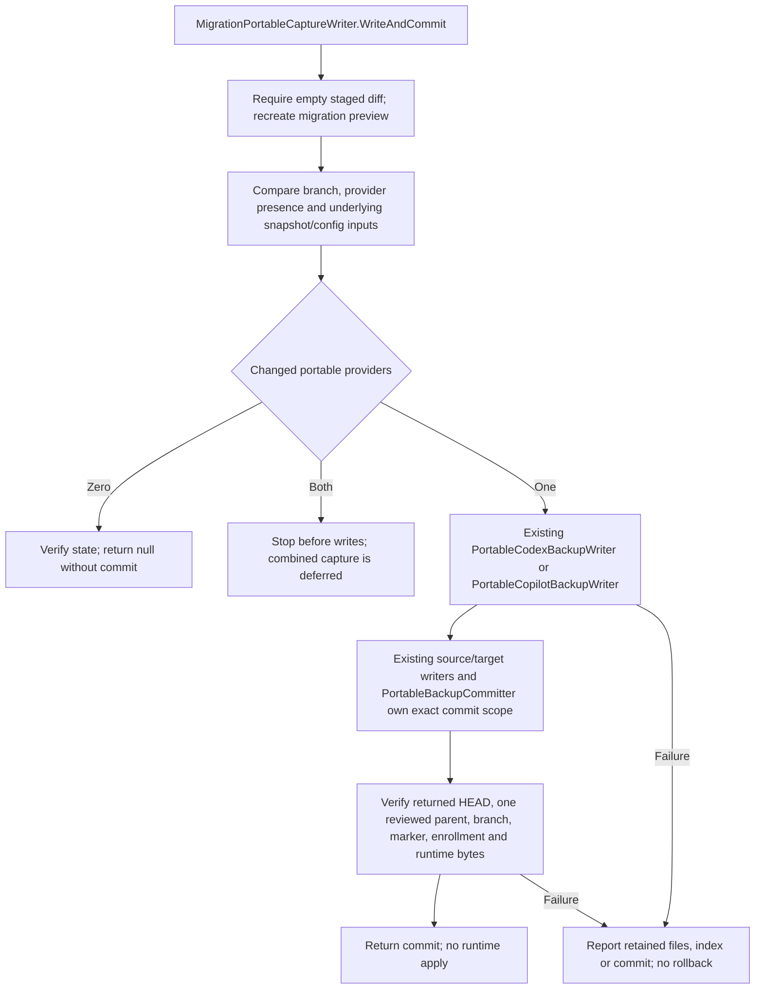

This adapter dispatches fresh derived proposals rather than caller-supplied
proposal fields. Existing backup code owns affected enrolled targets across all
platforms/providers; the adapter does not duplicate its rendering/path rules.
All selected runtime instruction files and Codex config—including skipped legacy
state—are checked before and after handoff. Preexisting staging is never unstaged.
No-op is validated; two changed providers stop even for identical shared proposals.
The first provider's commit would otherwise invalidate the second preview's target
baseline, so combined capture needs separate work, not a sequential fallback.
After a successful backup, runtime digests deliberately remain unchanged until an
approved apply. The adapter therefore verifies raw runtime bytes rather than
recreating a migration preview after commit. A concurrent edit can be detected,
not prevented atomically; failures may leave files, staging or a commit to inspect.
No runtime write, push, scaffolding, public route or automatic rollback is added.

### Internal combined portable authored-file writer

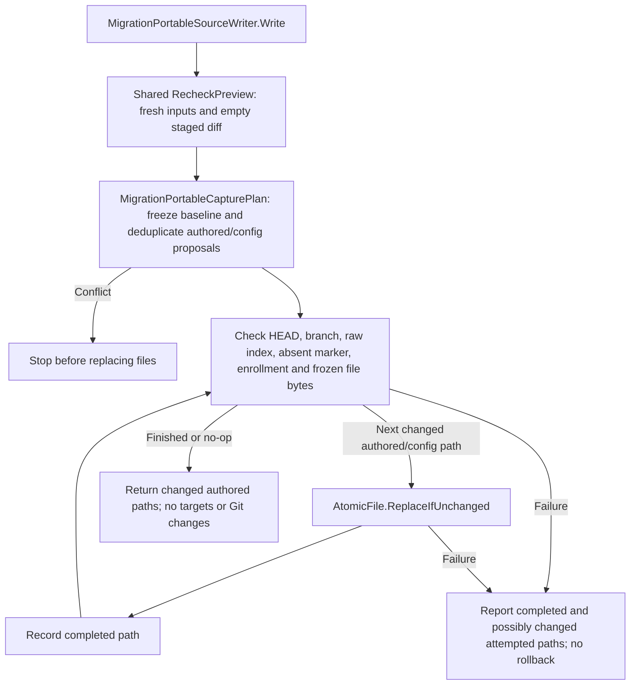

Identical shared/platform edits from both providers become one replacement;
separate overlays and managed personality can change in the same working-file batch.
Fresh proposals and fixed section paths supply destinations, not caller-held fields.
Unchanged relevant sources/targets and all selected runtime instruction/config bytes
are frozen too. A completed file must match its proposal; others retain baseline
bytes. Raw index bytes must remain identical, and staging is refused throughout.
Atomicity is per file, not a batch transaction. Failure retains inspectable partial
changes; the existing non-root Unix failure-fixture constraint still applies.
Targets intentionally remain at the old committed version at this boundary.
The target-only bridge below handles regeneration, and the separate combined
coordinator handles its commit. Public activation remains unfinished.
Clean-source previews reject these intentionally
dirty authored files. The existing
single-provider handoff still refuses two changed providers. No runtime deployment,
new enrollment, scaffolding, network operation or public command is added.

### Internal combined portable target-only writer

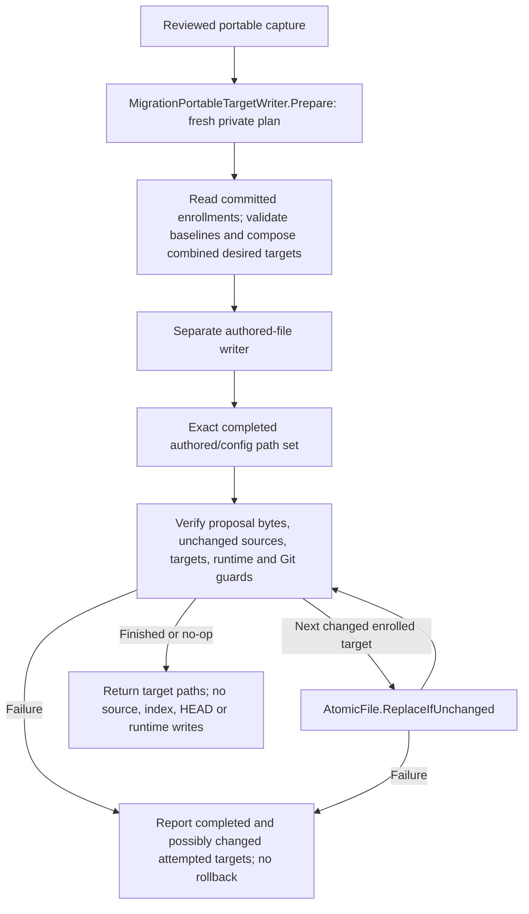

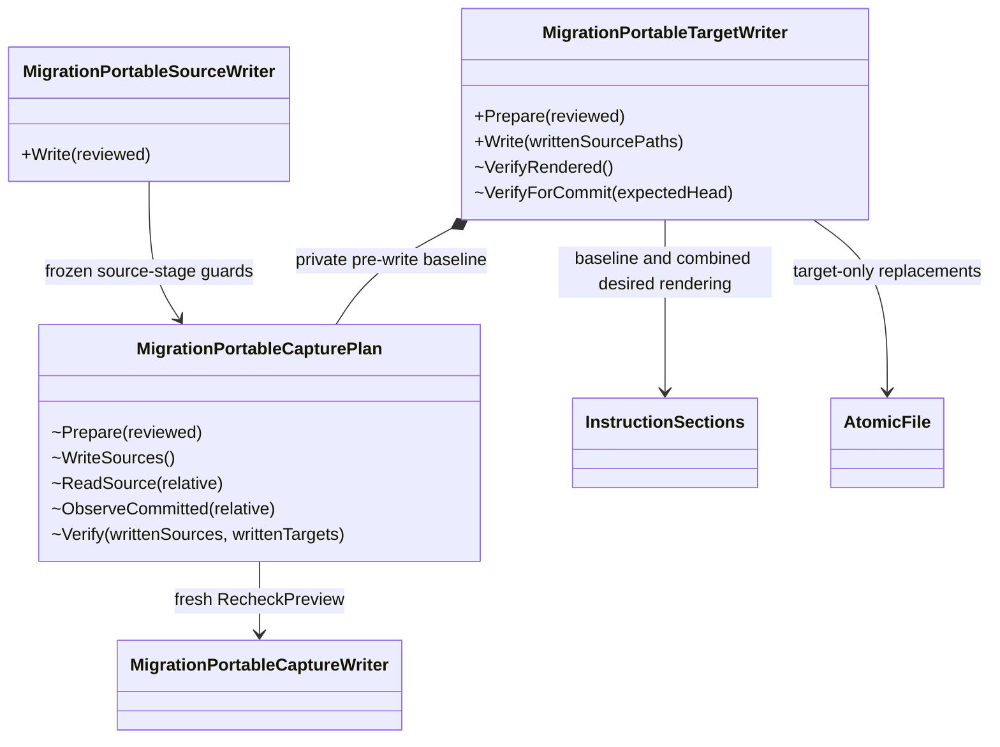

The plan exists only in memory and must be prepared before authored writes;
it is not a saved continuation or a public migration command. Shared edits affect
every committed enrollment, platform edits only that platform, and provider edits
that provider across platforms. Combined edits use the union and compose all
proposals together. No target or provider enrollment is created; config-only and
no-change capture render nothing. Unsupported committed target paths, dirty or
inconsistent baselines, links and oversized rendering stop before target writes.

The shared capture plan keeps fresh proposal buffers and enrollment private,
freezes consumed sources and all committed targets, and reuses the authored
writer's HEAD/branch/raw-index/marker/enrollment/runtime guards. The completed path
list must match exactly, and every authored/config byte must match its proposal;
it is not proof by path names alone. Rechecks surround each per-file replacement.
Failures retain partial targets for inspection, without rollback or batch atomicity.
No staging, commit, runtime write, network, scaffolding or public route is added.

### Internal combined portable capture coordinator

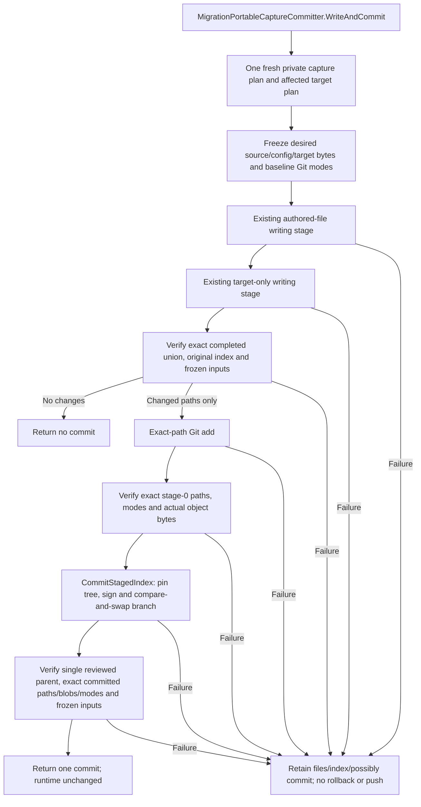

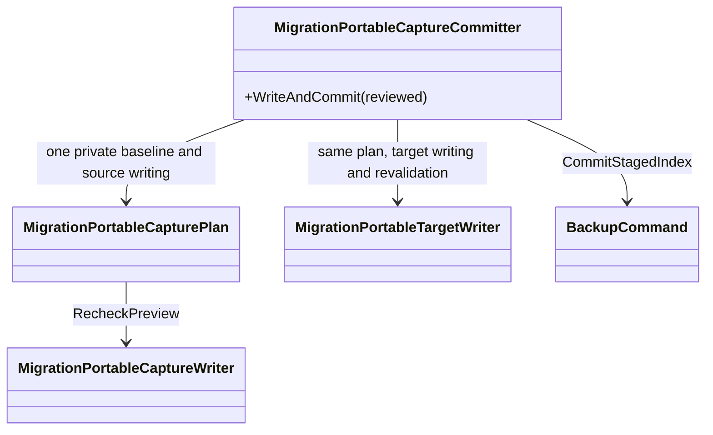

Both providers' agreeing or separate proposals share one commit, not sequential
single-provider commits that invalidate each other's baseline. Desired bytes are
copied from the private plan before writing, never hashed from mutable working
files as authority. Staged object size is checked before reading; staged and pinned
tree modes must match the original regular-file modes. Existing signing behavior
and the guarded branch update are retained. No-op still validates the full plan.

Default source/target-stage verification still requires the original raw index
and HEAD. Only the explicitly named commit boundary accepts the staged index or
new HEAD; it retains source/config/target bytes, branch, absent completion marker,
local enrollment and all selected runtime guards. The coordinator separately
verifies exact staged/committed paths and objects, and the final index must be clean.
Checks run as named, sequential guards with descriptive local values and explicit
runtime/canonical file loops. Staged entry, size parsing, expected size and content
comparison are separate checks; diagnostics identify the failing input. This
readability split does not add a validation framework or alter the boundaries above.
An error may retain authored files, targets, staging or a published local commit;
no batch atomicity, rollback, push or runtime deployment is claimed. The existing
single-provider adapter remains unchanged. This coordinator has no public route;
scaffold writing, completion orchestration and activation are separate stages.

### Internal migration scaffold preview

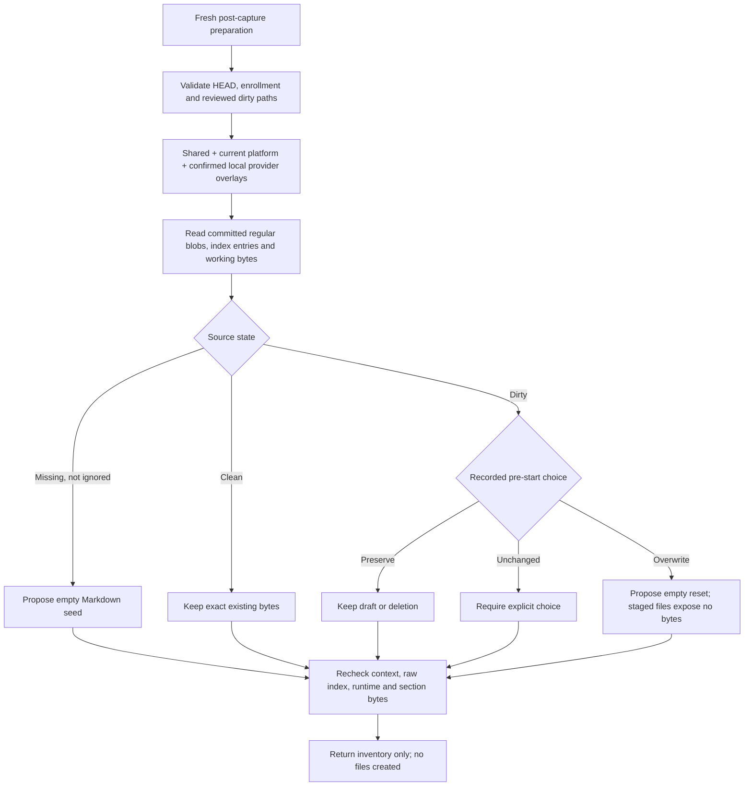

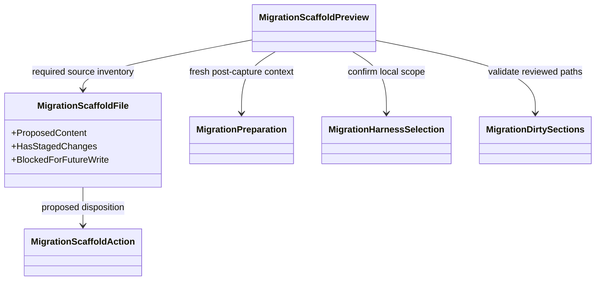

`MigrationScaffoldPreview.Read` proposes zero bytes for genuinely missing sources
or explicit pre-start Overwrite of dirty owned sections, including deletions.
Clean files remain unchanged under every choice. Preserve retains drafts/deletions;
An absent choice never authorizes a reset. Staged files expose no proposal bytes and stay
blocked. This preview describes replacements; only the separately validated writer
below executes them. Null `ProposedContent` means
no content proposal, not deletion. Uncommitted drafts may not be recoverable from
Git, as the choice prompt warns. No instruction classification, file/index write,
commit, transport or runtime write occurs; observations grant no reusable write authority.

The version preflight rejects an already completed 2.0 migration first. Sections
can exist during an incomplete attempt; their presence alone proves no completion.
The pre-start Overwrite choice must not be reapplied to expected user edits before
`DONE`. The internal confirmation gate and post-confirmation source checks are
described below; completion orchestration remains unimplemented.

### Internal scaffold creation and reset writer

```mermaid
flowchart TD
    Review[Reviewed scaffold preview] --> Fresh[One fresh full preview; compare inputs and actions]
    Fresh --> Block{Any staged or unresolved source?}
    Block -->|Yes| Stop[Stop before creating directories or files]
    Block -->|No| Freeze[Freeze raw index, protected bytes and existing Unix modes]
    Freeze --> Guard[Focused mutable-state checks; also cover no-op]
    Guard --> Next{Next planned action}
    Next -->|Preserve or already empty| NoWrite[No file replacement]
    NoWrite --> Next
    Next -->|Create or reset| Dirs[Local path guards; create missing parents and record directories]
    Next -->|Complete| Return[Return actually written paths]
    Dirs --> GuardAgain[Focused checks before file write]
    GuardAgain --> Missing{Working file absent?}
    Missing -->|Yes| Create[CreateNew empty file; never overwrite arrivals]
    Missing -->|No| Replace[Replace only matching reviewed bytes; retain permissions]
    Create --> Check[Focused checks; allow only completed creations and resets]
    Replace --> Check
    Check --> Next
    Dirs -->|Failure| Retain[Report retained files, directories and attempted path; no rollback]
    GuardAgain -->|Failure| Retain
    Create -->|Failure| Retain
    Replace -->|Failure| Retain
    Check -->|Failure| Retain
```

```mermaid
classDiagram
    MigrationScaffoldWriter --> MigrationScaffoldPreview : one fresh eligibility/history validation
    MigrationScaffoldWriter --> MigrationDirtySections : current dirty-path restrictions
    MigrationScaffoldWriter --> AtomicFile : WriteNew or ReplaceIfUnchanged
    MigrationScaffoldWriter --> MigrationScaffoldWriteException : partial write report
```

`MigrationScaffoldWriter.Write` ignores caller seed buffers and writes exactly
zero-byte files from its fresh fixed-path inventory. Clean files and Preserve
drafts remain unchanged; explicit Overwrite resets only reviewed unstaged sources.
Already-empty resets perform no file I/O and report no changed path. Every blocker stops the
whole operation before directory creation. Repository eligibility, initialization
history and committed blobs are validated in the entry preview, not rebuilt by
the write-boundary guards. Named,
focused checks then inspect mutable metadata/configuration, HEAD/branch/raw index,
marker, enrollment, dirty paths/ignore rules and working/protected bytes initially
and before/after each file write. With HEAD and index pinned, committed baseline
bytes and modes do not need rereading. Directory creation retains local link/
directory guards. Rechecks admit new dirty paths only for completed creations;
only a completed reset may remove an original dirty path by restoring committed
empty bytes. Exact section bytes remain pinned throughout. Existing Unix modes
are retained. Recreated deletions use owner-only `0600`, never restoring Git's
executable bit: instruction sections are data, not programs. Ordinary genuinely
missing seeds retain normal creation defaults; Windows uses native permissions.
Captured runtime/config
bytes protect this operation; the advisory preview did not store earlier runtime
bytes. A concurrent arrival is not overwritten. Checks are best-effort, not a
filesystem-wide transaction. Failures retain and report completed writes and
possibly changed attempted paths, including directories created before a later
pre-file validation detects drift. No staging, commit,
render, apply, transport, completion marker or public migration route is added.

### Internal DONE confirmation gate

```mermaid
flowchart TD
    Enter[Internal Wait call] --> Pre{Already cancelled?}
    Pre -->|Yes| Cancelled[Return Cancelled; no migration work]
    Pre -->|No| Explain[Explain prepared sections and later validation]
    Explain --> Read[Read line; check cancellation before and after]
    Read -->|EOF or cancellation| Cancelled
    Read -->|Line available| Exact{Exactly DONE?}
    Exact -->|No| Reminder[Print reminder; no default confirmation]
    Reminder --> Read
    Exact -->|Yes| Done[Return Done; later validation still required]
```

```mermaid
classDiagram
    MigrationDoneGate --> TextReader : synchronous line input
    MigrationDoneGate --> TextWriter : guidance and reminders
    MigrationDoneGate --> MigrationDoneResult : Done or Cancelled
```

`MigrationDoneGate.Wait` is an internal prompt only, not connected to the public
CLI or completion coordinator. It accepts exact ordinal `DONE`, without trimming
or case folding. Pre-cancellation performs no input/output; cancellation during
a read wins over `DONE`. A synchronous blocked read is not interrupted: cancellation
is observed when it returns. The gate touches no files or Git state and does not
validate or commit sources, render, apply, or record migration completion.
Edited sections are expected; the source preview below validates them without
reapplying the pre-start Overwrite choice. Completion orchestration is not wired.

### Internal post-DONE source validation

```mermaid
flowchart TD
    Input[Internal Read request; not public CLI] --> Entry[One entry preflight and ancestry check]
    Entry --> Snapshot[Capture branch, raw index and protected file bytes]
    Snapshot --> Dirty[Inspect current owned edits; ignore old dirty list and reset actions]
    Dirty --> Sources[Require regular bounded UTF-8 sources; reject staging]
    Sources --> Compose[Check markers and combined size by rendering in memory]
    Compose --> Recheck[Recheck mutable context, index and observed bytes]
    Recheck --> Preview[Return source snapshots and changed paths; no writes]
```

```mermaid
classDiagram
    MigrationSourceValidationPreview --> MigrationPreparation : pinned context and local harnesses
    MigrationSourceValidationPreview --> MigrationDirtySections : current owned edits
    MigrationSourceValidationPreview --> MigrationScaffoldPreview : fixed inventory and baseline helpers only
    MigrationSourceValidationPreview --> InstructionSections : in-memory composition
    MigrationSourceValidationPreview --> MigrationValidatedSource : baseline and exact working bytes
```

`MigrationSourceValidationPreview.Read` accepts the user's current section edits,
including empty/whitespace content and edits hidden by Git index flags. New empty
files are changes, not absent files. Required shared/current-platform/local-provider
sources must exist; staged, unrelated, ignored or unsafe changes stop the read.
Sources remain byte-exact, including CRLF. Structural validation does not assert
instruction coverage or quality, and no earlier Overwrite action is replayed.

History and committed blobs are read once at entry; named final guards check mutable
metadata, enrollment, marker absence, HEAD/branch/raw index and observed bytes.
Protected runtime/legacy/config snapshots cover this read only, not the preceding
user-editing wait; preparation contains no earlier byte snapshot. Observations
remain advisory: later commit code must revalidate them. No files, targets, Git
history/index, runtime, remote, completion marker or public command are changed.

### Internal source-only migration commit

```mermaid
flowchart TD
    Review[Reviewed source preview] --> Fresh[Fresh private validation; compare all reviewed sources]
    Fresh --> Freeze[Require local branch and empty staged diff; snapshot protected files and targets]
    Freeze --> Guard[Check context, index and working bytes]
    Guard --> Changes{Changed required sources?}
    Changes -->|No| Noop[Return null; no commit]
    Changes -->|Yes, including new empty files| Stage[Stage exact source paths only]
    Stage --> Verify[Verify stage-0 paths, modes, object sizes and exact bytes]
    Verify --> Publish[Existing signing-aware pinned-tree commit; compare old branch value]
    Publish --> After[Verify one parent, exact source tree, clean index and protected bytes]
    After --> Result[Return new commit ID]
    Stage -->|Failure| Retain[Retain staged state or new commit; no rollback]
    Verify -->|Failure| Retain
    Publish -->|Failure| Retain
    After -->|Failure| Retain
```

```mermaid
classDiagram
    MigrationSourceCommitter --> MigrationSourceValidationPreview : fresh private source buffers and guards
    MigrationSourceCommitter --> MigrationPortableTargetWriter : target path validation only
    MigrationSourceCommitter --> PortableBackupCommitter : require local branch
    MigrationSourceCommitter --> BackupCommand : CommitStagedIndex
    MigrationSourceCommitter --> MigrationCommitProof : immutable staged and committed objects
```

`MigrationSourceCommitter.Commit` never rewrites authored files. Newly created
required files are committed even when zero-byte; no-op means every required
source is already tracked and unchanged. Existing committed regular modes are
preserved; new sources require Git mode `100644`. Git transformations, hidden
index omissions or staged mode mismatches stop publication rather than changing
working files or clearing flags.

Only fresh private observations authorize staging. Existing target working bytes,
legacy/config/runtime bytes and source bytes are guarded around the index/commit
boundary. The shared helper preserves signing, pins the verified tree and updates
the expected local branch with its old commit as a guard. Index contents are checked
after publication; legitimate `write-tree` cache-extension updates are not mistaken
for user staging. Failure may retain index changes or a local commit for inspection;
there is no rollback, target generation, apply, push, marker or public CLI wiring.

### Internal single-harness migration target preview

```mermaid
flowchart TD
    Context[Post-source-commit preparation] --> Sources[Validate required sources: committed and byte-clean]
    Sources --> Select[Select one confirmed local harness and current platform]
    Select --> Target[Read exact target commit, index and working baseline]
    Target --> Clean{Working and index match baseline?}
    Clean -->|No| Stop[Refuse dirty, deleted, staged or untracked target]
    Clean -->|Yes| Render[Render selected shared, platform and provider sources in memory]
    Render --> Action{Target baseline?}
    Action -->|Absent| Create[Propose Create; require nonignored destination]
    Action -->|Matches render| Unchanged[Propose Unchanged]
    Action -->|Older than render| Regenerate[Propose Regenerate]
    Create --> Guard[Recheck mutable context, index and observed source, target and protected bytes]
    Unchanged --> Guard
    Regenerate --> Guard
    Guard --> Preview[Return advisory preview only]
```

```mermaid
classDiagram
    MigrationTargetPreview --> MigrationSourceValidationPreview : committed sources and final guard
    MigrationTargetPreview --> MigrationScaffoldPreview : fixed-path Git baseline and index readers
    MigrationTargetPreview --> InstructionSections : render selected three sources
    MigrationTargetPreview --> MigrationHarness : confirmed local selection
```

An older committed target may legitimately lag newly committed sections. Compare
it with its own exact Git baseline, not the new composition; do not use
`CommittedTargetValidator.Read`, which requires already-rendered parity. Create
requires absence from commit, index and working tree. Other harnesses and
platforms are not rendered. Observations cover this read, not earlier user edits,
and grant no write authority. No target write, staging, commit, apply, completion
marker or public command is added.

### Internal single-harness migration target writer

```mermaid
flowchart TD
    Review[Reviewed target preview] --> Fresh[Fresh preview; compare review, selection and source snapshots]
    Fresh --> Freeze[Pin raw index, permissions, required sources and protected working bytes]
    Freeze --> Guard[Validate mutable inputs]
    Guard --> Action{Fresh action?}
    Action -->|Unchanged| Noop[Return null without mutation]
    Action -->|Create| Parents[Create missing parents with link checks; recheck inputs]
    Parents --> Create[CreateNew target; Unix 0600]
    Action -->|Regenerate| Replace[Snapshot-checked atomic replacement; preserve Unix permissions]
    Create --> Verify[Verify exact target bytes and permissions; only selected target may be dirty]
    Replace --> Verify
    Verify --> Written[Return selected relative path]
    Parents -->|Failure| Stop[Report retained directories and attempted path; no rollback]
    Create -->|Failure| Stop
    Replace -->|Failure| Stop
    Verify -->|Failure| Stop
```

```mermaid
classDiagram
    MigrationTargetWriter --> MigrationTargetPreview : fresh private plan and all required sources
    MigrationTargetWriter --> AtomicFile : CreateNew or snapshot-checked replacement
    MigrationTargetWriter --> MigrationSourceValidationPreview : mutable-state guard
    MigrationSourceValidationPreview --> MigrationDirtySections : optional exact target context
    MigrationTargetWriter --> MigrationTargetWriteException : retained-state diagnostics
```

`RequiredSources` freezes every confirmed harness's required sources; `Sources`
remains the selected three-file composition. No caller buffer authorizes writes.
The target-aware dirty check validates one fixed target path, current platform
and confirmed provider. Ordinary source checks still reject every dirty target;
the writer admits only its exact intended change, not a general allowed-path
list. Guards inspect mutable state at write boundaries, without rebuilding full
preflight/history around each directory. Protected snapshots cover this write,
not earlier user review. Local permission tests cover Unix bits, not Windows ACLs.
Failures retain inspectable state; no staging, target
commit, runtime apply, marker, public CLI, rollback or remote operation is added.

### Internal single-harness target write and commit

```mermaid
flowchart TD
    Review[Reviewed target preview] --> Plan[Prepare private writer snapshots before any write]
    Plan --> Preconditions[Require local branch and empty staged diff]
    Preconditions --> Write[Existing guarded target writer]
    Write --> Changed{Target changed?}
    Changed -->|No| Noop[Return null; no commit]
    Changed -->|Yes| Stage[Stage only the selected target path]
    Stage --> Proof[Prove exact stage-0 mode, bounded object bytes and path]
    Proof --> Guard[Verify written state against private snapshots and staged index]
    Guard --> Commit[Signing-aware pinned-tree commit; expected branch and parent]
    Commit --> Verify[Verify one parent and exact committed target tree]
    Verify --> Clean[Prove index clean; verify protected working bytes and permissions]
    Clean --> Result[Return commit ID]
    Write -->|Failure| Retain[Retain working, staged or committed state; inspect before retry]
    Stage -->|Failure| Retain
    Proof -->|Failure| Retain
    Guard -->|Failure| Retain
    Commit -->|Failure| Retain
    Verify -->|Failure| Retain
    Clean -->|Failure| Retain
```

```mermaid
classDiagram
    MigrationTargetCommitter --> MigrationTargetWriter : Prepare, Write and named commit guards
    MigrationTargetCommitter --> MigrationCommitProof : staged objects and committed tree
    MigrationSourceCommitter --> MigrationCommitProof : same exact-path object proof
    MigrationTargetCommitter --> BackupCommand : unchanged signing and publication helper
```

`MigrationTargetWriter` retains a private prepared instance across these stages;
its existing static `Write(reviewed)` wrapper remains write-only. Desired bytes
leave that instance only as a defensive copy. Named staged/post-commit guards
accept the proven new index/HEAD while ordinary writer checks remain unchanged.
Do not recreate the ordinary preview after writing, or accept an independently
dirty target as an equivalent handoff. This is not a reusable trust receipt.

`MigrationCommitProof` extracts the source committer's existing bounded object,
mode, exact-path and parent checks. It owns no staging, signing or branch moves.
New Git targets require `100644`; existing regular Git modes are preserved,
separately from Unix working permissions. Filter transformations or mode
mismatches refuse publication. Failures retain inspectable state without
rollback, push or runtime apply. No public command or completion marker is added.

### Internal single-harness migration apply preview

```mermaid
flowchart TD
    Context[Committed migration context] --> Sources[Validate required sources and confirmed local harness]
    Sources --> Freeze[Snapshot raw index and protected instruction/config bytes]
    Freeze --> Existing[Reuse PortableApplyPreview for target, binding and desired runtime]
    Existing --> Head[Require same prepared HEAD and entry runtime snapshots]
    Head --> Objects[Compare target and Codex config with bounded actual Git objects]
    Objects --> Guard[Recheck context, sources, target, index and protected bytes]
    Guard --> Preview[Return advisory instruction and config proposals]
```

```mermaid
classDiagram
    MigrationApplyPreview --> MigrationSourceValidationPreview : committed sources and final mutable guard
    MigrationApplyPreview --> PortableApplyPreview : selected runtime proposal
    PortableApplyPreview --> PortableCodexConfigPreview : Codex managed-config proposal
    PortableApplyPreview --> ApplyCommand : staged diff, raw content hash and effective file mode
    MigrationApplyPreview --> MigrationLegacyCapturePreview : bounded no-replacement object reads
```

Accept a supported legacy runtime binding for a portable-upgrade proposal, or a
portable runtime for a no-op/drift proposal; never rebind another checkout or
platform. The instruction runtime must exist. Missing runtime config/personality
may yield the ordinary managed insertion proposal, without creating anything.
Codex config preserves unmanaged values; Copilot has no Codex config proposal.

The proposal must use one pinned HEAD and the entry runtime/config snapshots.
Compare deployment inputs with the actual committed tree, not Git replacement
views. Observations cover this read only; a future writer must freshly validate.
The shared committed-file reader checks staged changes against the commit, then
uses read-only `diff-files --raw -z` for effective Git modes and
`hash-object --no-filters` for exact content. Git interprets `core.filemode` for
the local filesystem; an equal-mode stat-only record is not a content change.
There is no worktree porcelain diff: it refreshed the index despite
`--no-optional-locks`, while disabling its refresh falsely rejected clean files.
Raw-index immutability checks remain strict. Global Git settings and explicit
staging/commit commands are unchanged.
No writes, staging, commits, runtime deployment, completion marker or public CLI.

### Internal Copilot migration apply writer

```mermaid
flowchart TD
    Review[Reviewed Copilot migration preview] --> Fresh[Fresh migration validation]
    Fresh --> Match[Compare reviewed paths, sources and instruction bytes]
    Match --> Before[Guard branch, HEAD, raw index and protected files]
    Before --> Writer[Reuse PortableInstructionWriter]
    Writer --> Expected[Admit only selected Copilot runtime bytes]
    Expected --> After[Recheck mutable migration state]
    After --> Result[Return applied or unchanged]
    Writer -. failure .-> Inspect[Runtime may be updated: inspect; no rollback]
    After -. failure .-> Inspect
```

```mermaid
classDiagram
    MigrationCopilotApplyWriter --> MigrationApplyPreview : refresh and compare review
    MigrationCopilotApplyWriter --> MigrationApplyReview : shared named input comparisons
    MigrationCopilotApplyWriter --> MigrationSourceValidationPreview : entry and post-write guards
    MigrationCopilotApplyWriter --> PortableInstructionWriter : one runtime instruction replacement
```

The writer derives paths and desired bytes from fresh validation, not caller
buffers. Reuse existing compare-before-replace and no-op behaviour. The final
guard admits only the selected runtime's desired bytes; repository/index,
required sources and other protected files retain their entry expectations.
History is checked at entry, not rescanned after each step. Post-write failures
retain inspectable state and report that runtime may be updated; no rollback is
attempted. No Codex config write, data commit, completion marker or public CLI.

### Internal Codex migration apply writer

```mermaid
flowchart TD
    Review[Reviewed Codex migration preview] --> Fresh[Fresh preview and shared review checks]
    Fresh --> Entry[Guard migration state]
    Entry --> Config[Guard and replace config if needed]
    Config --> Instructions[Admit expected config; guard and replace instructions if needed]
    Instructions --> Final[Admit only desired Codex bytes; verify migration state]
    Final --> Result[Return applied or unchanged]
    Config -. replacement failure .-> Inspect[Inspect runtime files; no rollback]
    Instructions -. partial failure .-> Inspect
    Final -. post-write failure .-> Inspect
```

```mermaid
classDiagram
    MigrationCodexApplyWriter --> MigrationApplyPreview : fresh committed inputs
    MigrationCodexApplyWriter --> MigrationApplyReview : instruction and config comparisons
    MigrationCopilotApplyWriter --> MigrationApplyReview : same common comparisons
    MigrationCodexApplyWriter --> PortableCodexWriter : config-first apply with production guards
    MigrationCodexApplyWriter --> MigrationSourceValidationPreview : bounded write-boundary and final checks
```

Production guards run before each actual replacement, separately from test
hooks. Keep ordinary Codex apply's pre-write refusal and partial-write warnings;
permission/argument failures after config also report possible partial updates.
Missing config uses the existing private-permission creation path. No-op writes
nothing but still gets the final migration guard. Only desired Codex config and
instructions may change; repository/index and Copilot remain protected. No full
history rescan per write, rollback, data commit, completion marker or public CLI.

### Internal enrolled-provider migration apply coordinator

```mermaid
flowchart TD
    Reviews[Review every enrolled provider] --> Validate[Refresh all reviews before any write]
    Validate --> Codex[Codex writer if enrolled]
    Codex --> Check[Admit only expected Codex changes; check shared state]
    Check --> Copilot[Copilot writer if enrolled]
    Copilot --> Final[Admit only expected Copilot changes; check shared state]
    Final --> Results[Return per-provider applied or unchanged]
    Codex -. failure .-> Stop[Stop; report completed writers and inspect runtime; no rollback]
    Check -. failure .-> Stop
    Copilot -. failure .-> Stop
    Final -. failure .-> Stop
```

```mermaid
classDiagram
    MigrationApplyCoordinator --> MigrationApplyPreview : refresh all reviewed providers
    MigrationApplyCoordinator --> MigrationApplyReview : compare each review
    MigrationApplyCoordinator --> MigrationCodexApplyWriter : first when enrolled
    MigrationApplyCoordinator --> MigrationCopilotApplyWriter : second when enrolled
    MigrationApplyCoordinator --> MigrationSourceValidationPreview : shared protected-state guard
    MigrationApplyCoordinator --> MigrationProviderApplyResult : per-provider outcome
```

Require exactly one review per enrolled provider, all from equivalent preparation
contexts. Refresh every review before writing; do not accept a changed second
provider after the first succeeds. Shared guards pin selected targets and protected
runtime/config bytes, admitting only each successful writer's expected changes.
Existing writers keep their own guards. No-op providers still pass the shared
check. Initial validation failures stop before writing. A provider-writer or
post-write guard failure stops later providers and reports which writers returned
and which runtime paths need inspection; returned results do not mean migration completed.
No rollback, repository writes, completion marker, status verification or public
CLI is added. The separately documented operating precondition still applies.

### Internal post-apply migration status gate

```mermaid
flowchart LR
    Context[Reviewed post-target-commit context] --> Validate[Validate enrolled providers and committed sources]
    Validate --> Inspect[PortableEnvironmentStatus for each enrolled provider]
    Inspect --> Guard[Verify phase-wide protected state]
    Guard --> Check{All in sync?}
    Check -->|Yes| Reports[Return provider reports; not migration completion]
    Check -->|No| Stop[Stop without repair or completion marker]
```

`MigrationStatusGate` reuses `MigrationSourceValidationPreview` for context and
the final guard, and `PortableEnvironmentStatus` for instruction/managed-config
comparison. Selected committed targets, protected runtime/config, sources,
index, HEAD and branch are compared across this read-only phase. This is
best-effort detection of persistent drift, not an atomic snapshot or lock. Missing
enrollment or stale context stops validation; status drift reports the provider
and instruction/config result. No marker is needed to inspect a migrated target.
A later completion writer must freshly validate again, not trust these reports.

### Internal migration completion preview

```mermaid
flowchart LR
    Context[Reviewed post-target-commit context] --> Capture[Capture sources, index and protected inputs]
    Capture --> Status[MigrationStatusGate: every provider in sync]
    Status --> Check[Verify preview-wide persistent state]
    Check --> Preview[Review proposed .aec-version: 2.0 plus newline]
```

`MigrationCompletionPreview` reuses source validation and the status gate.
It exposes the proposed ordinary non-executable Git mode `100644`, plus advisory
observations of commit/branch, index, sources and protected files. No marker is
created or committed by the preview. The marker-only writer below refreshes
these observations and handles its narrow transition. Ordinary guards still
reject an appearing marker. This remains best-effort observation, not a lock or atomicity.

### Internal completion marker writer

```mermaid
flowchart LR
    Review[Reviewed completion preview] --> Fresh[Refresh and compare all review inputs]
    Fresh --> Absent[Verify marker absent and context unchanged]
    Absent --> Create[CreateNew: exact marker, owner-only permissions]
    Create --> Guard[Verify exact marker, sole dirty path and protected state]
    Guard --> Result[Return uncommitted marker path]
    Create -. failure .-> Inspect[Retain inspectable state; no rollback or commit]
    Guard -. failure .-> Inspect
```

`MigrationCompletionWriter` reuses `AtomicFile.WriteNew`. Its post-write call
opts into exact marker bytes in `MigrationSourceValidationPreview` and the
fixed-path `MigrationDirtySections.ReadForCompletion` exception. All ordinary
calls still require marker absence. Raw index, HEAD/branch, enrolled harnesses,
source and protected bytes must remain unchanged; ignored markers are refused.
Unix creation uses `0600`, without executable bits. Existing or competing files
are not overwritten. Failures after an attempted write report that the marker
may remain; inspect before retrying. No staging, commit, runtime write or public
command is added, and an uncommitted marker does not complete migration.

```mermaid
classDiagram
    MigrationCompletionWriter --> MigrationCompletionPreview : refresh reviewed inputs
    MigrationCompletionWriter --> AtomicFile : WriteNew
    MigrationCompletionWriter --> MigrationSourceValidationPreview : exact-marker post-write check
    MigrationSourceValidationPreview --> MigrationDirtySections : ReadForCompletion only when opted in
```

### Internal completion marker committer

```mermaid
flowchart LR
    Review[Reviewed completion preview] --> Prepare[Fresh private prepared state]
    Prepare --> Write[Create and verify marker]
    Write --> Stage[Stage only marker; prove bytes, path and mode]
    Stage --> Commit[Publish verified tree with configured signing]
    Commit --> Proof[Prove one-parent marker-only commit]
    Proof --> Final[Verify clean index, new HEAD and protected state]
    Final --> Result[Return completion commit]
    Stage -. failure .-> Inspect[Retain marker, index or commit; no rollback]
    Commit -. failure .-> Inspect
    Final -. failure .-> Inspect
```

```mermaid
classDiagram
    MigrationCompletionCommitter --> MigrationCompletionWriter : Prepare private state
    MigrationCompletionCommitter --> MigrationCommitProof : exact staged and committed objects
    MigrationCompletionCommitter --> BackupCommand : CommitStagedIndex with signing
    MigrationCompletionWriter --> MigrationSourceValidationPreview : marker-aware phase checks
```

The writer's private prepared object retains fresh observations through the
whole operation; public preview buffers never become write authority. The
standalone `Write` entry point retains its marker-only behavior. After commit,
only the expected HEAD advancement and tracked/clean marker transition are
admitted. Ordinary migration preflight is not rerun against the completed format.
Signing or later validation failure leaves inspectable state and may leave a
commit; there is no reset, rollback, push or runtime deployment. The internal
component is not the public migration command or a stable-release acceptance.

### Internal post-DONE completion coordinator

```mermaid
flowchart TD
    Done[Caller has confirmed DONE] --> Sources[Validate and commit authored sources]
    Sources --> Targets[Freshly preview and commit each enrolled target]
    Targets --> Reviews[Prepare all apply reviews at final target HEAD]
    Reviews --> Apply[Apply reviewed providers]
    Apply --> Status[Fresh completion preview verifies status]
    Status --> Marker[Commit completion marker last]
    Marker --> Result[Return data commits, provider results and final commit]
    Sources -. failure .-> Stop[Stop; report pinned HEAD and retained state]
    Targets -. failure .-> Stop
    Apply -. failure .-> Stop
    Status -. failure .-> Stop
    Marker -. failure .-> Stop
```

```mermaid
classDiagram
    MigrationPostDoneCoordinator --> MigrationSourceCommitter : authored sources
    MigrationPostDoneCoordinator --> MigrationTargetCommitter : one enrolled provider at a time
    MigrationPostDoneCoordinator --> MigrationApplyCoordinator : all reviews before runtime writes
    MigrationPostDoneCoordinator --> MigrationCompletionPreview : fresh status
    MigrationPostDoneCoordinator --> MigrationCompletionCommitter : marker last
```

Preserve the original history anchor while advancing the pinned HEAD only to
verified component-returned commits. A no-op retains its prior HEAD; never
adopt an outside commit. Failures report the current phase, returned components,
pinned HEAD and underlying error; retained files/index/runtime/commits need
inspection, without rollback or automatic retry. Returned data commits contain
only source/target commits; the final marker commit is separate. The caller owns
the DONE gate. Preparation/capture/scaffold, prompts/warning, public dispatch and
personal migration are not added by this internal coordinator.

## Cross-machine boundary

```mermaid
flowchart LR
    A[(A: committed portable target)] -->|approved Git push| Remote[(Git remote)]
    Remote -->|explicit exact-byte clone or fetch + fast-forward| B[(B: same committed target)]
    A -->|apply with A binding| RuntimeA[A runtime: A checkout path]
    B -->|confirmed init; apply with B binding| RuntimeB[B runtime: B checkout path]
```

Git transfers portable source and target history. Init/apply generate each
runtime's local repository binding; they do not rewrite a shared path in Git.
Checkout must preserve committed bytes: clone with `--config core.autocrlf=false`
before checkout, without content-changing filters. Clean Git diff alone is not
byte-provenance proof; see the [clone instructions](reference.md#sharing-migrated-instructions-between-machines).
Status compares runtime with the local commit, so remote freshness requires the
separate tip check and approved Git transport. The shared round-trip test runs
Codex and Copilot cases against a local bare remote and two checkouts on one
platform. Cross-platform Native AOT and real-harness evidence remain separate
release work.

## Platform lifecycle verification boundary

```mermaid
flowchart LR
    Legacy[Disposable legacy init: both providers] --> Sources[Commit reviewed sources]
    Sources --> Codex[Enroll and commit Codex target]
    Codex --> Copilot[Enroll and commit Copilot target]
    Copilot --> Apply[Apply and check status per provider]
    Apply --> Backup[Edit one provider section; backup commits]
    Backup --> Drift[Runtime digest unchanged; status reports drift]
    Drift --> Refresh[Apply refreshes digest; status in sync]
    Refresh --> Render[Shared edit; render both targets only]
```

The macOS, Windows, and Linux smoke scripts keep installer/uninstaller checks in the same
disposable lifecycle. They preserve legacy files and unrelated runtime config,
check exact backup commit paths, and verify render changes neither runtime nor
Git history. Windows and Linux also check that uninstall preserves the previously applied
authored sections, all data files, and the other provider's runtime/skill.
Each manual workflow builds Native AOT before running its script. The macOS
managed-DLL fallback checks shell sequencing only; neither that nor OS-runner
smoke proves a real harness integration. The Windows 2.0 sequence passed managed
lifecycle/migration tests, Native AOT build, and isolated installer lifecycle in
[run 40201089188](https://github.com/ferrywlto/ai-env-as-code/actions/runs/40201089188)
at `8878d04`. The prior clone-attachment failure was resolved by preserving
checkout bytes in the test fixtures, not by relaxing production provenance checks.
The same Linux 2.0 two-provider sequence passed focused/migration tests, Native
AOT build, and the complete isolated installer lifecycle in
[run 40218058322](https://github.com/ferrywlto/ai-env-as-code/actions/runs/40218058322)
at `85fbd19`. This establishes Linux ARM64 runner/native behavior, not actual
Codex/Copilot harness integration.

## Classes: source composition and runtime inspection

```mermaid
classDiagram
    class AecApplication {
        +Run(args, output, error)
    }
    class SharedEnrollmentCommand {
        +Run(repository, provider, providerHome, output)
    }
    class RenderCommand {
        +Run(repository, output)
        +CurrentPlatform()
    }
    class InstructionSections {
        +Render(shared, platform, provider)
        +Parse(content, hasPlatform, hasProvider)
    }
    class PortableRuntimeSnapshot {
        +Read(repository, provider, providerHome)
        +Commit
        +Target
        +Runtime
    }
    class CommittedTargetValidator {
        +IsEnrolled(repository, commit, platform, provider)
        +Read(repository, platform, provider)
    }
    class InitCommand {
        +Run(repository, codexHome, forcePathChange)
    }
    class CopilotInitCommand {
        +Run(repository, copilotHome, forcePathChange)
    }
    class PortableEnvironmentStatus {
        +Inspect(repository, provider, providerHome)
    }
    class PortableApplyPreview {
        +Create(repository, provider, providerHome)
        +RenderDesiredRuntime(snapshot)
    }
    class PortableCodexConfigPreview {
        +Create(snapshot)
    }

    AecApplication --> SharedEnrollmentCommand : init --enroll-shared
    AecApplication --> InitCommand : ordinary Codex init
    AecApplication --> CopilotInitCommand : ordinary Copilot init
    AecApplication --> RenderCommand : render
    AecApplication --> PortableEnvironmentStatus : status
    AecApplication --> PortableApplyPreview : apply preflight
    SharedEnrollmentCommand --> InstructionSections : compose
    RenderCommand --> InstructionSections : compose
    PortableRuntimeSnapshot --> CommittedTargetValidator : read committed target
    InitCommand --> CommittedTargetValidator : enrolled attachment
    CopilotInitCommand --> CommittedTargetValidator : enrolled attachment
    PortableEnvironmentStatus --> PortableRuntimeSnapshot : inspect
    PortableEnvironmentStatus --> PortableCodexConfigPreview : Codex only
    PortableApplyPreview --> PortableRuntimeSnapshot : inspect
    PortableApplyPreview --> PortableCodexConfigPreview : Codex only
```

The snapshot binds a committed target to the current platform, selected data
repository, and local runtime control block. It is the common read boundary;
previews plan changes but do not authorize writes without revalidation.

## Classes: directional writes

```mermaid
classDiagram
    class AecApplication
    class PortableApplyPreview
    class PortableRuntimeSnapshot
    class PortableInstructionWriter {
        +Apply(reviewed)
    }
    class PortableCodexWriter {
        +Apply(reviewed)
    }
    class PortableCodexBackupPreview {
        +Create(repository, codexHome)
    }
    class PortableCopilotBackupPreview {
        +Create(repository, copilotHome)
    }
    class PortableBackupAttributionPreview {
        +Create(snapshot)
    }
    class PortableCodexBackupWriter {
        +WriteAndCommit(reviewed)
    }
    class PortableCopilotBackupWriter {
        +WriteAndCommit(reviewed)
    }
    class PortableBackupSourceWriter {
        +Write(snapshot, attribution)
    }
    class PortableBackupTargetWriter {
        +Render(snapshot, attribution)
    }
    class PortableBackupCommitter {
        +Commit(reviewed, renderedPaths)
        +Commit(snapshot, attribution, renderedPaths)
    }

    AecApplication --> PortableApplyPreview : Codex and Copilot apply
    AecApplication --> PortableCodexWriter : Codex apply
    AecApplication --> PortableInstructionWriter : Copilot apply
    PortableCodexWriter --> PortableInstructionWriter : instruction step
    AecApplication --> PortableCodexBackupPreview : Codex backup preflight
    PortableCodexBackupPreview --> PortableBackupAttributionPreview : attribute one section
    PortableCopilotBackupPreview --> PortableRuntimeSnapshot : read committed target and binding
    PortableCopilotBackupPreview --> PortableBackupAttributionPreview : attribute one section
    AecApplication --> PortableCodexBackupWriter : Codex backup
    PortableCodexBackupWriter --> PortableBackupSourceWriter : changed authored source
    PortableCodexBackupWriter --> PortableBackupTargetWriter : affected enrolled targets
    PortableCodexBackupWriter --> PortableBackupCommitter : exact-path commit
    AecApplication --> PortableCopilotBackupPreview : Copilot backup preflight
    AecApplication --> PortableCopilotBackupWriter : Copilot backup
    PortableCopilotBackupWriter --> PortableCopilotBackupPreview : recheck inputs
    PortableCopilotBackupWriter --> PortableBackupSourceWriter : one authored source
    PortableCopilotBackupWriter --> PortableBackupTargetWriter : affected enrolled targets
    PortableCopilotBackupWriter --> PortableBackupCommitter : exact-path commit
```

The Codex backup writer rechecks runtime inputs and Git state before replacing
canonical files, then commits only the affected paths. An interrupted
multi-file write can leave partial uncommitted changes, so it reports the need
to inspect rather than rolling back automatically. Copilot `status` and
`apply` use the portable target. Public Copilot `backup` now uses the same
snapshot and one-section attribution rules. Its writer rechecks the preview,
refuses pre-existing staged changes, and commits one attributed source plus
affected targets. The retained 1.x Copilot backup helper is not routed from
the public command.
