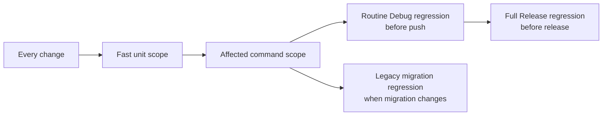

# Build, test, and run

Use these commands from the engine repository root unless stated otherwise.
You need the .NET 10 SDK. The integration tests also require Git. See the
[command reference](reference.md).

### Test strategy and expected duration



Run the fast unit suite after each edit. It runs in memory without Git.

```bash
dotnet test tests/Aec.Tests/Aec.Tests.csproj --filter "Category=Unit"
```

Run the affected integration tests before review and the routine Debug suite
before pushing. Run the legacy migration group when changing migration
behavior and the full Release suite before publishing. Full run times vary,
and the default console logger may stay quiet until the final summary.

<details>
<summary>Why full tests take longer</summary>

Integration tests use real Git repositories and check filesystem safety. Some
groups run sequentially because they change process-wide settings. See
`IMPLEMENTATION_CHECKLIST.md` for recorded regression runs.

Managed test fixtures default to the `fixtures` directory next to the test
binaries. Set `AEC_TEST_TEMP_ROOT` to an absolute, writable path without symbolic
links to override it. Set `TMPDIR` (or `TEMP` on Windows) to also direct the test
runner and its subprocesses to a particular temporary directory.

The production project uses only the .NET Base Class Library; tests use xUnit
without a coverage dependency.

</details>

To run a focused integration group, filter by test class.

```bash
# One affected command suite
dotnet test tests/Aec.Tests/Aec.Tests.csproj \
  --filter "FullyQualifiedName~PortableCodexBackupCommandTests"

# Broader migration and two-checkout rehearsals
dotnet test tests/Aec.Tests/Aec.Tests.csproj -c Release \
  --filter "FullyQualifiedName~LegacyMigrationTests|FullyQualifiedName~GitRoundTripTests"
```

#### Focused real-Git review

Choose `PortableReview` for ordinary Codex and Copilot backup, apply, and
status. Choose `MigrationReview` for exact migration commits, filter suppression,
signing failure, concurrent runtime drift, and scaffold retry.

```bash
(
  set -e
  review_category=PortableReview # Change to MigrationReview for migration.
  fixture_dir="$(mktemp -d "$(pwd -P)/.aec-review.XXXXXX")"
  trap 'rm -rf -- "$fixture_dir"' EXIT
  TMPDIR="$fixture_dir/" AEC_TEST_TEMP_ROOT="$fixture_dir" \
    dotnet test tests/Aec.Tests/Aec.Tests.csproj --filter "Category=$review_category" \
    --logger "console;verbosity=normal" \
    --blame-hang --blame-hang-timeout 2m --blame-hang-dump-type none
)
```

Prepend `/usr/bin/time -p` to the `dotnet test` invocation on macOS to measure
wall time. Add `--logger trx` to save per-test timings in the test results
directory. The inactivity guard aborts an unresponsive run. See the
[coverage map](../IMPLEMENTATION_CHECKLIST.md#focused-real-git-regression-checks)
for the selected checks and measured times.

#### Routine regression

The routine suite covers current commands and Git-free migration tests.

```bash
# Before push
dotnet test tests/Aec.Tests/Aec.Tests.csproj \
  --filter "Category!=LegacyMigration" \
  --blame-hang \
  --blame-hang-timeout 2m \
  --blame-hang-dump-type none
```

#### Legacy migration and release regression

The legacy group exercises the 1.x to 2.0 migration with real Git fixtures,
including public-command recovery. An unfiltered test run includes both
groups.

```bash
# When changing legacy migration
dotnet test tests/Aec.Tests/Aec.Tests.csproj \
  --filter "Category=LegacyMigration" \
  --blame-hang \
  --blame-hang-timeout 2m \
  --blame-hang-dump-type none

# Before release
dotnet test tests/Aec.Tests/Aec.Tests.csproj \
  --configuration Release \
  --blame-hang \
  --blame-hang-timeout 2m \
  --blame-hang-dump-type none
```

### Build and try commands

Use class-name filters above for focused testing. Replace example paths below
with your own. `backup` copies runtime changes into the data repository; `apply`
updates runtime files from committed repository content.

```bash
dotnet build src/Aec/Aec.csproj
dotnet run --project src/Aec/Aec.csproj -- version
dotnet run --project src/Aec/Aec.csproj -- help
dotnet run --project src/Aec/Aec.csproj -- \
  skill upgrade \
  --codex-home /absolute/path/to/codex-home
dotnet run --project src/Aec/Aec.csproj -- \
  uninstall \
  --codex-home /absolute/path/to/codex-home
dotnet run --project src/Aec/Aec.csproj -- \
  init \
  --repo /absolute/path/to/new-data-repository \
  --codex-home /absolute/path/to/codex-home
dotnet run --project src/Aec/Aec.csproj -- \
  init \
  --repo /absolute/path/to/data-repository \
  --provider=chatgpt
dotnet run --project src/Aec/Aec.csproj -- \
  status \
  --repo /absolute/path/to/data-repository \
  --codex-home /absolute/path/to/codex-home
dotnet run --project src/Aec/Aec.csproj -- \
  backup \
  --repo /absolute/path/to/data-repository \
  --codex-home /absolute/path/to/codex-home
dotnet run --project src/Aec/Aec.csproj -- \
  apply \
  --repo /absolute/path/to/data-repository \
  --codex-home /absolute/path/to/codex-home
```

### Experimental Native AOT build on Windows x64

Windows builds are experimental; real Windows Codex use remains unverified.
Install the .NET 10 SDK and Visual Studio 2022 or later with the Desktop
development with C++ workload, then run in PowerShell:

```powershell
./scripts/build-win-x64.ps1
```

The build writes `artifacts/aec-win-x64/aec.exe`.

<details>
<summary>Windows build and verification evidence</summary>

The manual-only
`.github/workflows/windows-smoke.yml` workflow builds it on a Windows x64
runner, checks `aec.exe version` and `aec.exe help`, and tests the isolated
installer/uninstaller plus both providers' portable lifecycle. The 2.0 script
uses reviewed sources, separate provider enrollment/target commits, directional
backup/apply/status checks, and shared rendering of both enrolled targets.
Uninstall preserves the applied authored sections, data files, and Copilot's
runtime/config/skill. See [the lifecycle diagram](architecture.md#platform-lifecycle-verification-boundary).

The updated Windows 2.0 sequence passed in
[run 40201089188](https://github.com/ferrywlto/ai-env-as-code/actions/runs/40201089188)
at `8878d04`: lifecycle tests 110/110, migration rehearsal 1/1, Native AOT build,
version/help, and the complete isolated installer lifecycle. Neither test scope
skipped tests. This is Windows runner/native proof, not real-harness verification.
The [earlier run](https://github.com/ferrywlto/ai-env-as-code/actions/runs/40141526871)
failed two clone-attachment tests; preserving committed bytes before clone checkout
resolved them without weakening production checks. Detailed evidence is indexed
in `IMPLEMENTATION_CHECKLIST.md`.
The workflow keeps the Git-heavy migration
rehearsal separate with a two-minute hang guard; smaller tests retain 30 seconds.

</details>

Install it for the current user. The default location is
`$env:LOCALAPPDATA\Programs\AEC\aec.exe`:

```powershell
.\scripts\install-win-x64.ps1
```

To choose another location, pass an absolute local-drive `-InstallDir`:

```powershell
.\scripts\install-win-x64.ps1 -InstallDir 'C:\Users\me\Tools\AEC'
```

Installation is idempotent, does not modify `PATH` or PowerShell execution
policy, and generates `scripts/uninstall-aec-win-x64.ps1` beside the installer.
If you change install directories, the old binary stays in place; the helper
tracks only the latest installation, so remove an unused older copy yourself.
If the selected directory is not already effective for Codex, expose it to
Codex yourself and restart Codex before it tries to discover `aec.exe`.

Run the generated helper by its explicit path:

```powershell
.\scripts\uninstall-aec-win-x64.ps1
.\scripts\uninstall-aec-win-x64.ps1 -CodexHome 'C:\Users\me\.codex'
```

It uses the exact installed binary to run `aec uninstall` before removing the
binary and helper script. The cleanup preserves the AEC data repository and `config.toml`.

### Experimental Native AOT build on Ubuntu Linux ARM64

On an ARM64 Ubuntu 24.04 machine, install Git, the .NET 10 SDK, `clang`, and
`zlib1g-dev`. Ubuntu installs the native build prerequisites with
`sudo apt-get install clang zlib1g-dev`. Then run from any directory:

```sh
/absolute/path/to/ai-env-as-code/scripts/build-linux-arm64.sh
```

The build writes `artifacts/aec-linux-arm64/aec`. Real Linux Codex use remains
unverified.

<details>
<summary>Linux build and verification evidence</summary>

The manual-only `.github/workflows/linux-arm64-smoke.yml` workflow builds on an
Ubuntu 24.04 ARM64 runner, checks `aec version` and `aec help`, and exercises the
isolated installer plus both providers' portable 2.0 lifecycle. The sequence is
shown in the [lifecycle diagram](architecture.md#platform-lifecycle-verification-boundary):
reviewed sources, separate enrollment/target commits, apply/status, exact-path
single-section backup, digest refresh, and both-target repository-only render.
Uninstall preserves the last-applied authored sections, all data files (including
unapplied render changes), and the other provider's runtime/config/skill.

The workflow runs focused lifecycle tests and a separate, two-minute-bounded
legacy migration rehearsal before the native build. The updated 2.0 sequence
[passed on Linux ARM64](https://github.com/ferrywlto/ai-env-as-code/actions/runs/40218058322)
at `85fbd19`: lifecycle 110/110, migration 1/1, Native AOT build, version/help,
and the complete isolated installer lifecycle. Neither test scope skipped tests.
This is Linux ARM64 runner/native proof; local macOS checks alone would not be.
The [historical runner pass](https://github.com/ferrywlto/ai-env-as-code/actions/runs/36283284376)
covers the older single-file Copilot flow, not this update. Neither is proof of
actual Codex/Copilot harness integration.

</details>

After building, install the executable for the current user:

```sh
./scripts/install-linux-arm64.sh
```

The default target is `$HOME/.local/bin/aec`. To use another absolute directory:

```sh
./scripts/install-linux-arm64.sh --install-dir /absolute/path/to/bin
```

Installation is idempotent and does not change `PATH` or shell profiles. A
custom directory produces a warning because the `$aec` skill finds `aec`
through the `PATH` inherited by Codex. The installer generates
`scripts/uninstall-aec-linux-arm64.sh` beside itself; run that exact path to
remove AEC runtime integration before deleting the installed binary and helper:

```sh
./scripts/uninstall-aec-linux-arm64.sh
./scripts/uninstall-aec-linux-arm64.sh --codex-home /absolute/path/to/.codex
```

The helper verifies its own generated path and the installed executable digest.
It preserves the AEC data repository and `config.toml`, and stops without
deleting installation files if AEC runtime cleanup fails. A real Linux Codex
harness remains unverified, so the matrix entry stays ⚠.

### Native AOT on Apple-silicon macOS

Apple-silicon macOS is the platform verified with real Codex use. Building
requires Git, the .NET 10 SDK, and Xcode Command Line Tools:

```bash
./scripts/build-osx-arm64.sh
```

The build writes `artifacts/aec-osx-arm64/aec`. Scripts locate the repository
from their own location, so they also work when invoked from another directory.

<details>
<summary>macOS build and verification evidence</summary>

The manual-only `.github/workflows/macos-arm64-smoke.yml` workflow uses a
macOS 15 ARM64 runner to build the Native AOT executable, check `aec version`
and `aec help`, and exercise the isolated installer/uninstaller plus both
providers' portable lifecycle. The script commits the reviewed sources, enrolls
and commits one target at a time, then checks apply/status, single-section
backup, digest refresh, idempotence, and repository-only rendering. Legacy
canonical files and unrelated Codex/Copilot configuration remain intact.

The [earlier macOS run](https://github.com/ferrywlto/ai-env-as-code/actions/runs/36283284718)
passed the previous lifecycle; it is not verification of this updated 2.0 sequence.
The updated sequence passed locally through the freshly built Native AOT artifact
on 2026-10-24. After an approved retry with local socket permission, the separated
managed scopes also passed: 110 focused lifecycle tests and one legacy migration
rehearsal. Current verification details are in `IMPLEMENTATION_CHECKLIST.md`.
See [the verification boundary](architecture.md#platform-lifecycle-verification-boundary).
The Git-heavy migration rehearsal runs separately with a two-minute hang guard;
smaller focused tests retain 30 seconds. A watchdog abort is not a passing run
or proof of a product deadlock.
The workflow never reads the personal AEC data repository. Codex on macOS is
marked ✓ because it has also been exercised with the real local harness, not
merely because CI exists.

</details>

After a successful build, install it for the current user:

```bash
./scripts/install-osx-arm64.sh
```

The default target is `$HOME/.local/bin/aec`. An explicit absolute directory can
be selected instead:

```bash
./scripts/install-osx-arm64.sh --install-dir /absolute/path/to/bin
```

When the selected directory differs from `$HOME/.local/bin`, installation continues
but prints a warning because the `$aec` skill invokes `aec` through Codex's `PATH`.
Make the directory available to Codex, restart Codex, and verify `aec help`.

The installer never uses `sudo` or changes shell profiles or `PATH`. If
`$HOME/.local/bin` is not already on `PATH`, configure the shell yourself, for
example:

```bash
export PATH="$HOME/.local/bin:$PATH"
```

### Codex cannot find a newly installed `aec`

Codex inherits its `PATH` when the app starts. Therefore, if `aec` was installed
or its directory was added to `PATH` while Codex was already running, Codex can
report that `aec` is unavailable even though a new terminal can execute it. Fully
quit and restart Codex, then run `aec help` again. Starting a new task is not
enough because it stays in the existing app process.

This restart is only for executable discovery. After `aec skill upgrade` replaces
`SKILL.md`, no restart or new task is required.

After building, validate both the default and custom installation behavior with:

```bash
./tests/install-osx-arm64.sh
```

The installed Native AOT executable does not require .NET. To upgrade, update the
source checkout, rerun the build and installer scripts, then run
`aec skill upgrade`. Reinstalling identical executable bytes reports
`unchanged`; upgrading already-current skill guidance also reports `unchanged`.

The macOS ARM64 installer generates `scripts/uninstall-aec.sh` in the same folder
as `scripts/install-osx-arm64.sh`. Run it by its explicit path, so it can safely
remove itself after the runtime cleanup succeeds:

```bash
./scripts/uninstall-aec.sh
```

For a non-default Codex home, pass its absolute path:

```bash
./scripts/uninstall-aec.sh --codex-home /absolute/path/to/.codex
```

The script calls the exact binary selected by the latest installation; it does not
depend on `PATH`. It first runs `aec uninstall`, then removes that binary and the
generated script only on success. It preserves every AEC data repository and all
runtime `config.toml` bytes. Reinstalling at a new directory updates this generated
script to that latest binary; an earlier binary remains untouched and can be removed
manually if no longer wanted.

