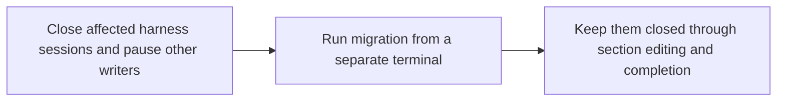
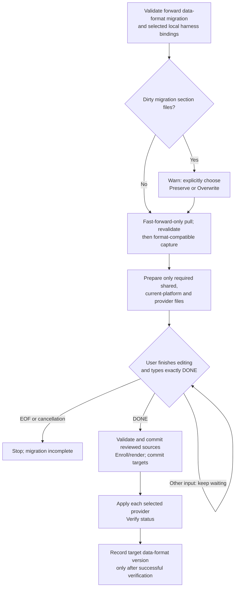
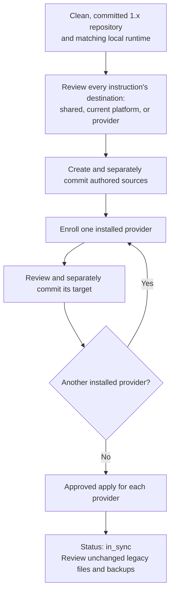

# Migration to AEC 2.0

Move an existing 1.x data repository to the shared-instruction layout.
Installing a new AEC executable alone does not migrate your data.
See also the [reference](reference.md) and [README](../README.md).

### Migration operating precondition



> Close all affected harness sessions and pause other tools that modify the selected AEC
> repository or its managed runtime configurations. Keep them closed until
> migration finishes. Concurrent changes may cause migration to stop with
> partially updated state.

Use a separate terminal and a plain editor for both migration methods below.
AEC warns before the command changes anything, but does not detect or close
running applications for you.

### Interactive migration command



Run from a separate terminal:

```sh
aec migrate 2.0 --repo ABSOLUTE_PATH
```

1. **Review the starting state.** AEC checks the repository format, selected
   local harnesses and tracked remote. It may fetch and fast-forward, but never
   pushes or automatically merges conflicting changes.
2. **Choose what to do with unfinished section edits.** Type `Preserve` to keep
   them or `Overwrite` to empty the eligible files for refilling. Overwrite can
   permanently lose uncommitted edits. There is no default choice. Unrelated or
   staged changes can stop migration; Preserve does not bypass Git checks.
3. **Edit the shared, platform and provider sources.** You decide where each
   instruction belongs. AEC does not classify the text. Use a plain editor and
   keep affected harnesses and other writers closed.
4. **Review, then type exactly `DONE`.** AEC validates and commits the sources
   and targets, updates the selected harnesses, and checks their status. It
   records data format `2.0` only after all checks pass.

Only confirmed local harness bindings on the current platform are selected;
folders in the repository alone do not select a harness. Unrelated settings,
manual backups and existing Git history are preserved. Migration does not
install the executable or upgrade skills.

Other input keeps the editing prompt open. EOF or cancellation stops with an
error; there is no resume flag. If Ctrl+C is pressed while input is waiting,
press Enter to release the pending read. Rehearse on disposable copies before
using real data.

### If migration stops

Migration does not undo completed steps. It may leave changed files, staged
changes, local commits, or updated harness files. Inspect these before retrying.
An uncommitted `.aec-version` file can block the next attempt; resolve it
explicitly. A new invocation starts from the beginning.

<details>
<summary>For maintainers: implementation checks</summary>

The command checks inputs again before each write. Its main stages are:

| Stage | Checks and result |
|---|---|
| Prepare | Validate the data format, local harness bindings, edited files and tracked remote. Fetch objects, then advance only when safe. |
| Capture | Compare local harness changes with the repository. Stop on conflicts; never silently replace newly retrieved instructions. |
| Edit | Prepare missing source files. Preserve existing edits unless the user explicitly chooses Overwrite. Staged or unrelated edits block writing. |
| Commit | Validate reviewed sources, regenerate affected targets, and commit only the selected paths. |
| Apply | Update Codex, then Copilot when selected. Preserve unrelated settings. Stop later updates if one fails. |
| Complete | Require every selected provider to report `in_sync`, then commit `.aec-version`. |

Writes are protected per file, not as one all-or-nothing operation. A failure
retains the completed work for inspection. Checks do not lock out other tools.

Remote queries have a 30-second limit; fetching has a two-minute limit, each
with up to one second for cleanup. Tests with local remotes do not establish
SSH or HTTPS transport verification. Migration suppresses external Git filters
without changing user settings. Files requiring those filters, managed LFS
pointers, enabled/custom fsmonitor and submodules are refused. Git's built-in
text conversions still apply to upstream-updated files.

For class relationships and detailed stage contracts, see the
[architecture](architecture.md#internal-codex-migration-apply-writer).

</details>

### Existing manual migration — implemented and rehearsed



This is the supported **2.0 development-branch data migration** using the current
command syntax. Installing the executable or upgrading a skill does not migrate
the data. Instruction classification is manual in both migration flows.
Meet the [migration operating precondition](#migration-operating-precondition)
before starting this sequence; current individual commands do not print the
top-level migration warning.
The example below covers Codex and Copilot used on the same machine; omit the
Copilot source, enrollment, and deployment when that harness is not used.

1. Before replacing the 1.x executable, use its `status` to inspect runtime drift.
   Resolve any drift with a separately approved 1.x capture or deployment. Start
   from a clean, committed data repository; retain its commit ID and the old
   executable. Pending manual ChatGPT backups require their own review and commit.
   The 2.0 `status`, `backup`, and `apply` require committed targets, so they cannot
   reconcile a legacy-only repository before enrollment. If already upgraded,
   pause for that baseline review rather than trying 2.0 backup as a bootstrap.
2. Install the 2.0 development executable and upgrade the Codex skill separately
   with `aec skill upgrade`. Confirm each selected local home belongs to this
   checkout. If attaching a different checkout path, use ordinary provider `init`
   and obtain approval before `--force-path-change`, as described below. Keep
   both local harnesses on the same checkout.
3. Review a complete split of the **existing committed** instruction bodies,
   excluding only AEC-generated control blocks. Account for every paragraph,
   code example, and unclassified instruction before applying. Put common rules
   in shared once, OS/path rules in the current platform, and harness mechanics
   in its overlay. Resolve conflicting rules explicitly; AEC cannot prove the
   semantic completeness of an arbitrary split. Create only the sources in use:

   | Authored source | Review scope |
   |---|---|
   | `environment/shared/instructions.md` | Rules for all enrolled harnesses |
   | `environment/platforms/<platform>/policy.md` | This platform's approved rules |
   | `environment/providers/codex/overlay.md` | Codex mechanics |
   | `environment/providers/copilot/overlay.md` | Copilot mechanics, if used |

   Preserve the existing provider instruction files, canonical Codex `config.toml`,
   and `environment/providers/chatgpt/`. Review the new files, stage their exact
   paths, inspect the staged diff, and separately approve their source commit.
4. Enroll **one provider at a time**, then review and separately commit its exact
   target before enrolling another. Enrollment writes no runtime or Git commit:

   ```text
   aec init --repo ABSOLUTE_PATH --enroll-shared
   # Review and commit environment/targets/<platform>/codex/AGENTS.md

   aec init --repo ABSOLUTE_PATH --provider=copilot --enroll-shared
   # Review and commit environment/targets/<platform>/copilot/copilot-instructions.md
   ```

   `<platform>` is `macos-arm64`, `windows-x64`, or `linux-arm64` for the current
   machine. Use the selected `--codex-home`/`--copilot-home` consistently if custom
   homes are required. Attempting the second enrollment while the first target
   is uncommitted stops with `changes outside the selected enrollment target`.
5. After reviewing and committing the targets, separately approve deployment:

   ```text
   aec apply --repo ABSOLUTE_PATH
   aec status --repo ABSOLUTE_PATH
   aec apply --repo ABSOLUTE_PATH --provider=copilot
   aec status --repo ABSOLUTE_PATH --provider=copilot
   ```

   Require `in_sync` for instructions and Codex config. Before the first apply,
   legacy control blocks may report instruction drift; that is expected. Verify
   the managed personality and unrelated runtime settings are retained. Legacy
   provider files, manual backups, and Git history stay available for review.
   Partial apply failures require inspection of both Codex runtime files before
   retrying; no automatic rollback is performed.

With no further edits, repeating enrollment, render, and apply reports
`unchanged`; `status` remains `in_sync`. Repeating ordinary init preserves an
already-bound portable runtime. An explicitly authorized backup of that unchanged
runtime reports `unchanged` without a commit. These reruns do not authorize a
new instruction split, overwrite a dirty target, or replace manual ChatGPT data.
These currently implemented commands perform no remote operations; use the
separately approved Git workflow for publication and retrieval.

`LegacyMigrationTests` rehearses the manual sequence through public commands with a
disposable 1.x-format repository, both local homes, a supplied lossless split,
non-default personality, unrelated runtime settings, and manual ChatGPT backup
bytes. It checks preservation, per-provider commit boundaries, usable 2.0
status/apply/backup, and safe reruns. This is local managed-code evidence, not
execution of a historical binary, Native AOT smoke, or real-harness verification.
Separate `MigrationCommandTests` cover public command confirmation, EOF and
fresh-start recovery on disposable fixtures.

