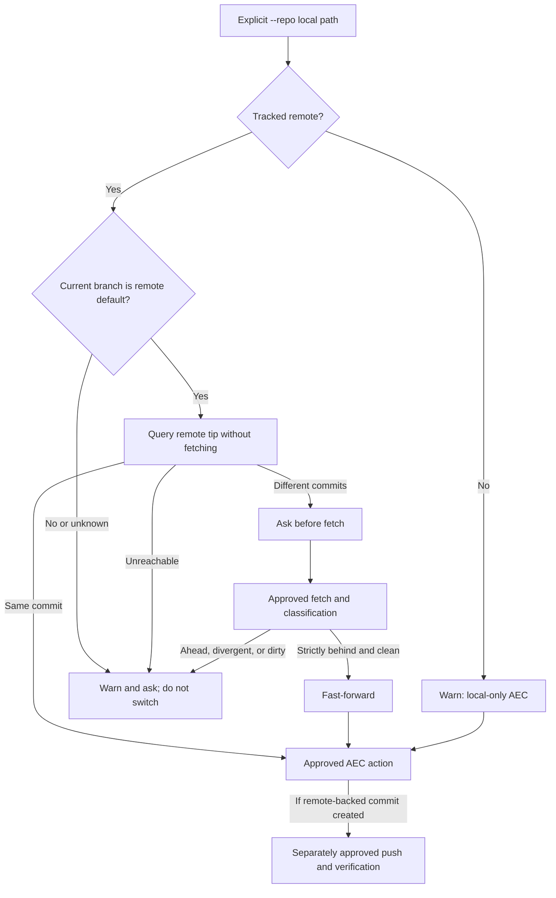
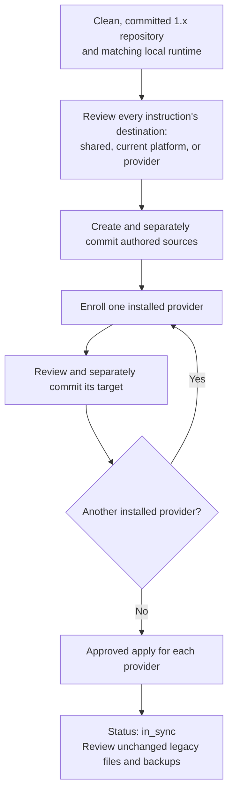
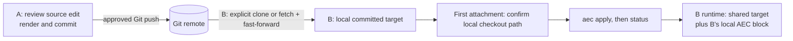
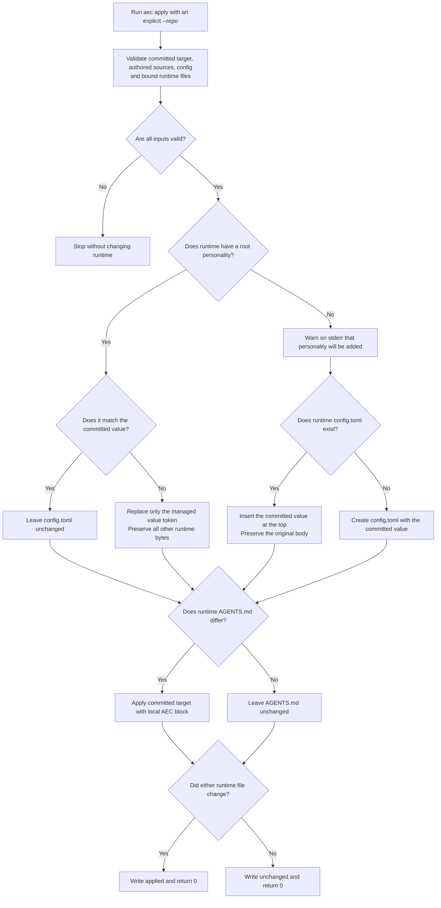
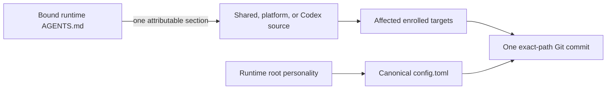
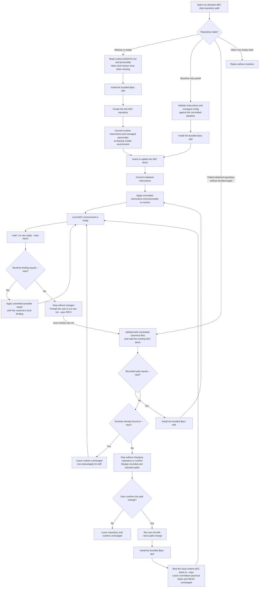
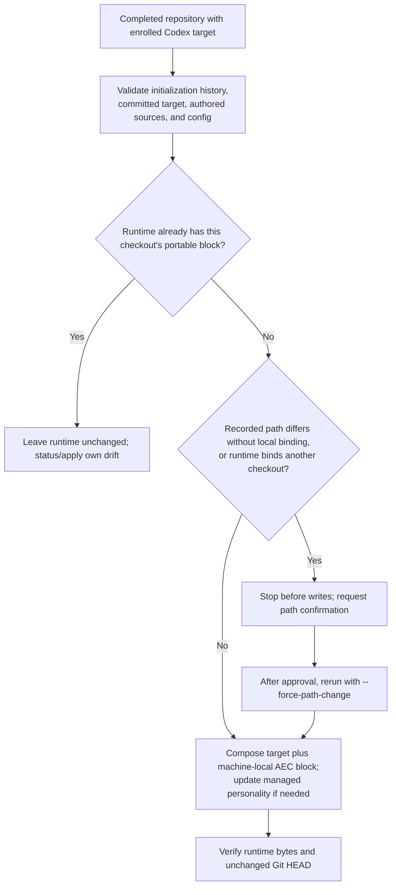
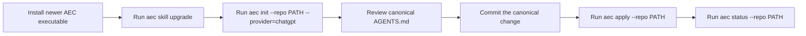
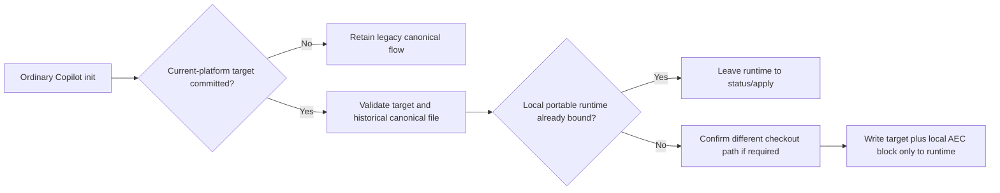

# AI Environment as Code — detailed reference

This is the command, release-history, build, and troubleshooting reference.
For the diagram-first overview, see the [project README](../README.md).
Shell commands with relative paths assume the engine repository root unless
their section says otherwise.

Version 2.0.0-alpha.4 adds host-agnostic Git remote preflight guidance to the
bundled skills. `aec render` and enrollment are repository-only. On the
development branch, ordinary `apply` and `status` use committed portable
targets. Both providers' `backup` commands now capture portable authored
sources; ordinary `init` retains its provider-specific flow. These
development changes are not yet a released binary. See the
[approved design](shared-instructions-design.md). Copilot remains alpha
and is not verified against the real harness on any platform.

## Version history

| Version | Increment |
|---|---|
| 0.1 | Project initialization |
| 0.2 | `init` command |
| 0.3 | `backup` command |
| 0.4 | `init` AEC instruction injection and update |
| 0.5 | `apply` command |
| 0.6 | ChatGPT provider initialization |
| 0.7 | Install the `$aec` Codex skill during ordinary `init` |
| 0.8 | Require explicit repository-aware initialization |
| 0.9 | Commit-first initialization through `backup` and `apply` |
| 0.10 | Attach pulled repositories and explicitly rebind moved paths |
| 0.11.1 | Compare managed Codex `personality` state through `status` |
| 0.11.2 | Apply committed Codex `personality` while preserving runtime config |
| 0.11.3 | Back up runtime Codex `personality` with runtime instructions |
| 0.11.4 | Enroll Codex `personality` in the initial environment baseline |
| 0.12.0 | Report the executable version through the `version` command |
| 0.13.0 | Upgrade recognized official Codex skill guidance explicitly |
| 0.13.1 | Diagnose a running Codex process with a stale executable `PATH` |
| 1.0.0 | First stable release after private end-to-end dogfooding |
| 1.1.0 | Remove AEC runtime instructions and exact official skill files |
| 1.2.0 | Generate a contained uninstaller beside the macOS ARM64 installer |
| 1.2.1 | Apply recommended Roslyn analysis and behavior-preserving cleanup |
| 1.2.2 | Centralize test application execution and Git environment isolation |
| 1.2.3 | Harden backup path containment and Git object verification |
| 1.3.0 | Route managed Codex changes through the bundled `$aec` skill |
| 1.3.1 | Attach completed repositories that include the AEC ChatGPT scaffold |
| 1.4.0-alpha.1 | Initialize native GitHub Copilot CLI instructions and the local AEC skill |
| 1.4.0-alpha.2 | Align Codex, Copilot, and ChatGPT engine source paths by provider |
| 1.4.0-alpha.3 | Smoke-test Copilot initialization through the Windows x64 Native AOT artifact |
| 1.4.0-alpha.4 | Inspect Copilot canonical/runtime instruction drift without mutation |
| 1.4.0-alpha.5 | Capture Copilot runtime instructions into one verified canonical commit |
| 1.4.0-alpha.6 | Apply committed canonical Copilot instructions to the local runtime |
| 1.4.0-alpha.7 | Exercise the complete Copilot lifecycle in an isolated macOS ARM64 workflow |
| 1.4.0-alpha.8 | Add the complete Copilot lifecycle to the isolated Linux ARM64 workflow |
| 2.0.0-alpha.1 | Add internal shared-instruction composition without changing runtime commands |
| 2.0.0-alpha.2 | Add section boundaries and repository-only rendering for enrolled targets |
| 2.0.0-alpha.3 | Enroll one current-platform/provider target from committed authored sources |
| 2.0.0-alpha.4 | Guide safe remote preflight and separately approved publication through the bundled skills |

The development CLI reports `2.0.0-alpha.4` through `aec version`.

## Git remote transport (skill guidance)



The CLI itself never fetches, pulls, or pushes. The bundled skills run this
preflight only before an AEC canonical write or runtime apply—not on every
reply. They identify a cloned repository's remote through the current branch's
upstream and query its advertised `HEAD`, assuming neither `origin` nor `main`.
Equal tips need no fetch; different tips do not establish which is newer.
Fetch and any strictly-behind fast-forward require approval. Ambiguous tracking,
an unreachable remote, pre-existing worktree changes, or a non-default branch
pause the operation. The skill never automatically pulls, merges, rebases,
switches branches, or force-pushes. A new repository without a remote remains
local-only with a warning. Before a separately approved push, show its
destination and ask if it differs from the fetch remote.

For routine source-first instruction edits, publish an approved commit before
`aec apply` so another machine can retrieve the same canonical version. Ordinary
Codex `init` is a known exception: its fixed internal lifecycle commits and
applies locally before a separately approved external push. `aec status` remains
a local canonical/runtime comparison, not a remote-status check.

## Shared-instruction enrollment (2.0 development)


The three sources are `environment/shared/instructions.md` for rules across
enrolled harnesses, `environment/platforms/<platform>/policy.md` for local paths or OS
rules, and `environment/providers/<provider>/overlay.md` for one harness's
mechanics. AEC does not classify existing instructions automatically. An empty
overlay is valid when reviewed and committed for an enrolled provider.

After the ordinary Codex or Copilot provider initialization is complete and
the three sources exactly match committed Git files, opt in with one of:

```text
aec init --repo ABSOLUTE_PATH --enroll-shared [--codex-home ABSOLUTE_PATH]
aec init --repo ABSOLUTE_PATH --provider=copilot --enroll-shared [--copilot-home ABSOLUTE_PATH]
```

The selected provider home and its managed runtime instruction file must exist
outside the data repository and be bound to it. Enrollment validates the
completed AEC repository and committed provider baseline, then
creates only the selected target under
`environment/targets/<platform>/<provider>/`. It never changes runtime,
stages, commits, or pushes. A repeat with the same target reports `unchanged`;
a different existing target is not overwritten. `--force-path-change` and
`--provider=chatgpt` cannot be combined with `--enroll-shared`.
For a pulled checkout at a different path, first confirm ordinary provider
`init` so this machine's runtime binds to `--repo`. Enrollment can then proceed
even if the clean committed legacy provider block still names the original
machine's checkout; it never rewrites that canonical block.

## Migrating an existing 1.x repository to 2.0



This is the supported **2.0 development-branch data migration** using the current
command syntax. Installing the executable or upgrading a skill does not migrate
the data. There is no automatic instruction classification or migration command.
The example below covers Codex and Copilot used on the same machine; omit the
Copilot source, enrollment, and deployment when that harness is not used.

1. Before replacing the 1.x executable, use its `status` to inspect runtime drift.
   Resolve any drift with a separately approved 1.x capture or deployment. Start
   from a clean, committed data repository; retain its commit ID and the old
   executable. Pending manual ChatGPT backups require their own review and commit.
   The 2.0 `status`, `backup`, and `apply` require committed targets, so they cannot
   reconcile a legacy-only repository before enrollment. If already upgraded,
   pause for that baseline review rather than trying 2.0 backup as a bootstrap.
2. Install the 2.0 development executable and upgrade the Codex skill separately
   with `aec skill upgrade`. Confirm each selected local home belongs to this
   checkout. If attaching a different checkout path, use ordinary provider `init`
   and obtain approval before `--force-path-change`, as described below. Keep
   both local harnesses on the same checkout.
3. Review a complete split of the **existing committed** instruction bodies,
   excluding only AEC-generated control blocks. Account for every paragraph,
   code example, and unclassified instruction before applying. Put common rules
   in shared once, OS/path rules in the current platform, and harness mechanics
   in its overlay. Resolve conflicting rules explicitly; AEC cannot prove the
   semantic completeness of an arbitrary split. Create only the sources in use:

   | Authored source | Review scope |
   |---|---|
   | `environment/shared/instructions.md` | Rules for all enrolled harnesses |
   | `environment/platforms/<platform>/policy.md` | This platform's approved rules |
   | `environment/providers/codex/overlay.md` | Codex mechanics |
   | `environment/providers/copilot/overlay.md` | Copilot mechanics, if used |

   Preserve the existing provider instruction files, canonical Codex `config.toml`,
   and `environment/providers/chatgpt/`. Review the new files, stage their exact
   paths, inspect the staged diff, and separately approve their source commit.
4. Enroll **one provider at a time**, then review and separately commit its exact
   target before enrolling another. Enrollment writes no runtime or Git commit:

   ```text
   aec init --repo ABSOLUTE_PATH --enroll-shared
   # Review and commit environment/targets/<platform>/codex/AGENTS.md

   aec init --repo ABSOLUTE_PATH --provider=copilot --enroll-shared
   # Review and commit environment/targets/<platform>/copilot/copilot-instructions.md
   ```

   `<platform>` is `macos-arm64`, `windows-x64`, or `linux-arm64` for the current
   machine. Use the selected `--codex-home`/`--copilot-home` consistently if custom
   homes are required. Attempting the second enrollment while the first target
   is uncommitted stops with `changes outside the selected enrollment target`.
5. After reviewing and committing the targets, separately approve deployment:

   ```text
   aec apply --repo ABSOLUTE_PATH
   aec status --repo ABSOLUTE_PATH
   aec apply --repo ABSOLUTE_PATH --provider=copilot
   aec status --repo ABSOLUTE_PATH --provider=copilot
   ```

   Require `in_sync` for instructions and Codex config. Before the first apply,
   legacy control blocks may report instruction drift; that is expected. Verify
   the managed personality and unrelated runtime settings are retained. Legacy
   provider files, manual backups, and Git history stay available for review.
   Partial apply failures require inspection of both Codex runtime files before
   retrying; no automatic rollback is performed.

With no further edits, repeating enrollment, render, and apply reports
`unchanged`; `status` remains `in_sync`. Repeating ordinary init preserves an
already-bound portable runtime. An explicitly authorized backup of that unchanged
runtime reports `unchanged` without a commit. These reruns do not authorize a
new instruction split, overwrite a dirty target, or replace manual ChatGPT data.
The CLI performs no remote operations; use the separately approved Git workflow
for publication and retrieval.

`LegacyMigrationTests` rehearses this sequence through public commands with a
disposable 1.x-format repository, both local homes, a supplied lossless split,
non-default personality, unrelated runtime settings, and manual ChatGPT backup
bytes. It checks preservation, per-provider commit boundaries, usable 2.0
status/apply/backup, and safe reruns. This is local managed-code evidence, not
execution of a historical binary, Native AOT smoke, or real-harness verification.

## Sharing migrated instructions between machines



Use the migration sequence above to publish a committed enrolled target from A.
Git may use any host; AEC does not perform the transport. On another machine:

1. Clone the selected data repository to its chosen absolute path. Install/select
   the selected local harness home separately; a pulled target does not create
   or activate it.
2. Run `aec init --repo ABSOLUTE_PATH` for Codex, or add `--provider=copilot` for
   Copilot. If the recorded checkout path differs,
   obtain confirmation and rerun with `--force-path-change`. This changes local
   runtime instructions/config as needed, while committed canonical files and
   Git HEAD stay unchanged. A conflicting other implicit harness still stops.
3. Run `aec apply --repo ABSOLUTE_PATH` and `aec status --repo ABSOLUTE_PATH`;
   add `--provider=copilot` to both for Copilot. Use the selected provider's home
   option consistently when custom homes are required.
   Both machines share committed authored text; each runtime block names its own
   checkout. The initial apply may report `unchanged` because init already used
   the committed portable target.
4. For later updates, A reviews the source/target change, commits, and obtains
   push approval. B checks its tracked remote's advertised default-branch tip;
   after approval, explicitly fetches and fast-forwards only a clean, strictly
   behind checkout. Then B separately applies and verifies status. See the remote
   preflight above for ahead, divergent, dirty, or unreachable states.

Before fetching, B's status can still report `in_sync` against its **old local
commit**. It does not prove remote freshness. After fast-forwarding to a changed
target, status reports drift until apply. Neither status nor apply silently
fetches, pushes, merges, or changes the checkout's Git HEAD.

`GitRoundTripTests` runs the same sequence separately for Codex and Copilot with
two different paths and a local bare remote named `shared`: real push/clone,
a later push, read-only tip inspection, explicit fetch/fast-forward, and
apply/status. It checks equal portable targets, distinct runtime bindings,
retained history/config, and no unused provider target or other harness home
on B. Copilot's `config.json` remains byte-identical; only Codex manages root
personality. This is managed-code Git integration on one host/platform, not
two real machines, a network service, Native AOT, or real-harness verification.

## Shared-instruction rendering (2.0 development)

```text
aec render --repo ABSOLUTE_PATH
```

`render` uses the current supported platform (`macos-arm64`, `windows-x64`, or
`linux-arm64`) and only provider target directories already present under
`environment/targets/<platform>/`. Each enrolled Codex or Copilot target requires
committed Git history and these user-authored sources:

```text
environment/shared/instructions.md
environment/platforms/<platform>/policy.md
environment/providers/<provider>/overlay.md
```

It writes only changed canonical target files under
`environment/targets/<platform>/<provider>/`; it neither initializes a target
directory nor changes a runtime, stages, commits, or pushes. Each output contains
AEC-owned markers around the three authored sections. A target already edited
outside this render flow is preserved and reported as an error. Review and commit
the source and target changes together. Public `status`, `apply`, and `backup`
consume committed enrolled targets; backup attributes supported runtime edits
to the authored sources before rendering affected targets.

## Approved development decisions

- AEC supports local harness configurations. Cloud-hosted use is outside the
  current scope.
- Releases remain alpha/beta until they have been exercised with the actual
  target harness; a version number alone is not a claim of harness validation.
- The platform/provider roadmap starts with Codex on Windows and Linux, then
  Copilot, Claude, and Gemini on macOS, Windows, and Linux.
- GitHub Actions is manual-only through `workflow_dispatch`. After explicit
  authorization, a run may be started with `gh workflow run`; pushes do not
  start CI automatically.
- `act` can provide local feedback for suitable Linux-container jobs, but it
  does not validate the Windows x64 environment from an ARM Mac.
- CI uses isolated fixtures and never reads or writes the personal AEC data
  repository.

The Windows x64 installer and real Windows Codex harness remain experimental;
the practical details are documented beside the Windows build instructions
below.

## Local harness verification

| Harness | macOS ARM64 | Windows x64 | Linux ARM64 |
|---|---|---|---|
| Codex | ✓ Verified | ⚠ Not verified | ⚠ Not verified |
| GitHub Copilot | ⚠ Alpha, not verified | ⚠ Alpha, not verified | ⚠ Alpha, not verified |
| Claude | ⚠ Not verified | ⚠ Not verified | ⚠ Not verified |
| Gemini | ⚠ Not verified | ⚠ Not verified | ⚠ Not verified |

✓ means AEC has been exercised with the actual local harness on that platform.
⚠ means it has not. The passing Windows build and isolated installer CI test do
not verify AEC against a real Windows Codex harness.

Copilot's three platform entries mean its isolated AEC lifecycle is covered on
those platforms. They are not evidence that Copilot CLI itself has been installed
or exercised on any platform.

## version

```text
aec version
```

`version` reports the installed AEC executable release without reading or changing
a data repository or runtime state. It accepts no options or operands. The former
`aec --version` form is unsupported.

## skill upgrade

```text
aec skill upgrade [--codex-home ABSOLUTE_PATH]
```

Executable installation and skill-guidance upgrade are deliberately separate:


The newly installed executable supplies the latest bundled guidance. The user may
run `aec skill upgrade` directly or explicitly ask Codex to run it; the command is
never inferred merely because a newer release may exist. It updates only:

```text
<codex-home>/skills/aec/SKILL.md
<codex-home>/skills/aec/agents/openai.yaml
```

It takes no `--repo` because it neither reads nor changes an AEC data repository.
An explicit absolute `--codex-home` takes precedence over a non-empty `CODEX_HOME`;
when both are absent, the command uses `~/.codex`.
Both managed files are checked before either changes. Only exact official v0.9.0,
v0.10.0, v0.11.4, v0.12.0, v0.13.0, v1.0.0, v1.1.0, and v1.2.3 predecessors—or the current bundle—are
accepted. Missing, modified, unsupported, linked, or otherwise invalid managed
state fails closed. A retry safely completes a recognized old/current mixture,
unrelated files are preserved, and replaced files retain their existing Unix
permission bits.

The command writes `upgraded` when it replaces guidance or `unchanged` when both
files are already current. It does not download, build, or install the executable;
change Git, AEC data, runtime `AGENTS.md` or `config.toml`; or touch other skills.
No Codex restart or new task is required for this skill-only update. The next
request that selects `$aec` reads the updated installed `SKILL.md` guidance.

## uninstall

```text
aec uninstall [--codex-home ABSOLUTE_PATH]
```

`uninstall` removes AEC's Codex runtime integration while the executable is still
available to perform the cleanup. It accepts no `--repo` and never reads, changes,
commits, or deletes an AEC data repository.

After preflighting every target, the command:

- removes the exact supported v3 through v6 AEC block from runtime `AGENTS.md`;
- preserves every non-AEC instruction byte;
- removes only exact current or recognized official predecessor copies of
  `skills/aec/SKILL.md` and `skills/aec/agents/openai.yaml`;
- preserves unrelated skills and extra files under the AEC skill directory; and
- leaves runtime `config.toml`, including `personality`, byte-for-byte unchanged.

An unmanaged `$aec` reference outside the managed instruction block, a customized
managed skill file, malformed instructions, linked paths, or another invalid target
stops the command before its first mutation. Instructions are removed before skill
files, so a retry can finish a recognized interrupted cleanup. It writes
`uninstalled` when anything was removed and `unchanged` when no managed integration
remains.

## apply

```text
aec apply --repo ABSOLUTE_PATH [--codex-home ABSOLUTE_PATH]
```

`apply` has the opposite data-flow direction from `backup`:

```text
committed <repo>/environment/targets/<platform>/codex/AGENTS.md
  + local AEC control block -> existing <codex-home>/AGENTS.md
committed <repo>/environment/providers/codex/config.toml personality
  -> <codex-home>/config.toml personality
```

The repository must be the exact root of a non-bare Git working tree with a
committed `HEAD`. Detached HEAD is accepted because `apply` does not create a commit.
The enrolled target, its three authored sources, and canonical config must match
their committed bytes. An existing runtime `AGENTS.md` must carry a supported
binding to the selected repository and platform; a missing runtime file or path
mismatch stops and directs the caller to ordinary `aec init`. Malformed or
unsupported markers also fail closed. `apply` never accepts
`--force-path-change`. Unrelated repository changes are ignored and untouched.

The managed configuration decision is intentionally non-interactive:



An existing managed value is normalized only when its meaning differs; comments,
line endings, unrelated root settings, tables, and other bytes remain intact. A
missing value produces a warning on standard error, then the same invocation inserts
the committed value at the top or creates the missing runtime file. Invoking `apply`
is already the authorization, so there is no second confirmation prompt.

On Unix, an existing runtime config retains its permission bits and a newly created
config is restricted to the current user. A planned result over 1 MiB is rejected
before either runtime file changes.

Both runtime plans are validated before mutation. Each changed file is written
through its own flushed sibling temporary file, compare-before-replace check, and
post-write verification. Two separate files cannot form one portable atomic
transaction; interruption between them is safe to detect and resume with `status`
and another `apply`. A runtime target inside the data repository is rejected.

The command writes `applied` when either runtime file changes or `unchanged` when
neither needs a write; both return exit code 0.

There is no separate backup, receipt, Git mutation, commit, or push.

## backup

```text
aec backup --repo ABSOLUTE_PATH [--codex-home ABSOLUTE_PATH]
```

`backup` has one explicit runtime-to-repository direction:



The selected repository must have a symbolic local branch and a committed,
clean, enrolled target for the current platform and Codex. Runtime instructions
must be bound to that
repository and stamped with the current target digest. Backup accepts zero or
one changed authored instruction section, and an independent managed root
personality change; a config-only change is valid. Control-block edits,
multiple changed sections, missing enrollment, wrong binding, or a stale
target digest stop before writing. Missing runtime `config.toml` or root
`personality` warns and stops. Invalid TOML stops with an error.

Before writing, backup rechecks the runtime inputs and refuses an already
staged index. It replaces only changed canonical sources and regenerates every
affected committed target, including enrolled targets for other platforms.
The managed personality update preserves canonical formatting and does not
copy unrelated runtime TOML. Exact changed paths form one commit with subject
`Backup portable Codex environment`. The command writes `committed <full-sha>`
or `unchanged`; both return exit code 0. Validation and Git failures return 1.
If a later step fails after a file replacement, inspect the uncommitted
repository state before any retry; files are individually guarded, not one
filesystem transaction.

There is no separate backup directory or backup manifest. Git commit history is the
source of truth. `backup` does not push or write runtime state; `apply` remains the
separate repository-to-runtime command.

## init

```text
aec init --repo ABSOLUTE_PATH [--codex-home ABSOLUTE_PATH] [--force-path-change]
```

`init` creates a data repository in a missing or empty directory. It may also resume
only a recognizable baseline-only partial initialization, or attach a clean,
completed AEC repository pulled to the selected path. Other non-empty targets are
rejected. `--repo` is required and must be the absolute path of that source-of-truth
repository. The current working directory and engine repository are never inferred.

`--codex-home` selects the runtime root. When omitted, `init` uses a non-empty
`CODEX_HOME` and then `~/.codex`, matching the other commands. The Codex home must
already exist. Fresh and baseline-only initialization require its regular
`AGENTS.md`; a missing runtime fails before repository or skill mutation. Runtime
`config.toml` may be missing, but any existing file must be valid supported TOML.
If its root `personality` is absent, `init` warns that `none` will be enrolled and
waits until both initialization commits succeed before adding it to runtime. A
completed pulled repository may create either missing runtime file from committed
canonical state, or from its enrolled current-platform target when present.

During ordinary Codex or Copilot init without an explicit home flag, AEC reads
the other harness's implicit home (`CODEX_HOME`/`COPILOT_HOME`, then
`~/.codex`/`~/.copilot`). If its managed runtime block names a different data
repository, init stops before writing, even with `--force-path-change`.
No other-harness home is created. This 2.0 alpha guard does **not** discover
explicit custom homes; those flags still work, but users must keep both
harnesses on one checkout themselves.

Ordinary `init` also installs these bundled skill metadata files:

```text
<codex-home>/skills/aec/SKILL.md
<codex-home>/skills/aec/agents/openai.yaml
```

Only those two files are managed. Missing files are created, identical files are
retained without rewriting, and unrelated skills or extra files are preserved. A
different existing managed file is treated as a conflict and is never overwritten;
the command fails before creating the repository or changing runtime instructions.
This permits multiple data repositories to share one exact skill installation.

The skill invokes `aec` by command name and stops if it is unavailable on Codex's
`PATH`. The developer-built macOS ARM64 Native AOT workflow is documented below,
but `init` does not search for, build, or run an engine checkout as a fallback. It
still fails closed when either managed skill file differs. After installing a newer
AEC executable, use `aec skill upgrade` to replace an exact recognized official
predecessor; modified or unknown files are never overwritten.

A resumable target must be a `main` repository containing one recognized root
baseline. Current baselines use `Backup Codex environment` and contain exactly the
runtime `AGENTS.md` bytes plus canonical managed `config.toml`; legacy baselines use
`Backup Codex AGENTS.md` and contain only the runtime instructions. The runtime
managed value must still agree semantically with a current baseline, while both a
missing value and explicit `none` agree with a committed `none`. The working
canonical files may contain only the baseline or exact expected managed result.
Baseline lookalikes, unrelated changes, links, and special entries are rejected.

A completed repository must retain the recognizable two-commit initialization
ancestry, use symbolic branch `main`, contain a real `.git` directory whose metadata
remains inside the selected root, and have a clean index and work tree. Both current
canonical files must exactly match committed `HEAD`; instructions must contain a
supported v3 through v6 AEC block and config must contain one supported managed value.
Legacy histories remain attachable after canonical config was added in a later
commit. A truly pre-config completed `HEAD` fails closed instead of inventing state.
Later commits and committed provider files are allowed.

The AEC-managed instruction block is delimited and versioned explicitly:

```markdown
<!-- AEC:BEGIN version=5 -->
## AI Environment as Code

Use the `$aec` skill for changes to managed personal Codex instructions or configuration.

The AEC data repository selected by `--repo` is `/absolute/path/to/data-repository`.
Treat its Git commit history as the source of truth.
The canonical Codex instructions are `/absolute/path/to/data-repository/environment/providers/codex/AGENTS.md`.
Preserve instructions outside this managed block; do not edit the runtime `AGENTS.md` as the source of truth.

For repository-to-runtime changes, edit and commit the canonical source, run `aec apply`, then verify with `aec status`.
Use `aec backup` only for an explicitly authorized runtime-to-repository capture.
If AEC is unavailable or validation fails, stop without changing managed runtime state.
<!-- AEC:END -->
```

When no block exists, `init` inserts it at the logical top of the canonical copy,
after an optional UTF-8 byte-order mark, followed by one blank separator line and
the existing instructions. An older version is replaced in place. A current block
is retained byte-for-byte when it already contains the expected managed content and
`--repo` path; otherwise that block is reconciled in place. Duplicate, malformed,
or newer-version markers, invalid UTF-8, NUL bytes, and merged content over 1 MiB
are rejected.

For a fresh target, an explicit `init` invocation authorizes this fixed lifecycle:

```text
runtime AGENTS.md + runtime personality (missing means none)
  -> canonical AGENTS.md + canonical config.toml
  -> commit: Backup Codex environment
  -> reconcile only the canonical AEC instruction block
  -> commit: Initialize AEC instructions
  -> apply both committed managed files to runtime
```

The root commit preserves exact runtime instruction bytes and records only the
managed personality, not machine-owned runtime config. The second commit changes
only instructions and is always created, including as an empty commit when the
baseline already has the exact current block. A recognized legacy baseline resumes
after its existing AGENTS-only root and introduces canonical config in that second
commit without rewriting history. Runtime remains untouched until both commits
succeed. Apply then preserves unrelated runtime TOML while adding or replacing only
`personality`; it stops if either managed runtime value changed since preflight. Git
hooks are isolated, line-ending conversion is disabled locally, exact staged bytes
are verified, and the command does not push. No separate `backup` or `apply`
invocation is needed.

A failure before the second commit leaves the runtime untouched and a recognizable
baseline may resume. A failure after the second commit leaves a complete repository.
Rerunning ordinary `init` at the recorded path uses the attachment flow without
another backup or commit. An unenrolled repository applies its legacy canonical
environment; an enrolled Codex repository uses its committed portable target.

### Pulled-repository initialization

The following flow covers fresh initialization and attachment before the Codex
portable target is enrolled. It never silently changes the recorded path:



When a current-platform Codex target is committed, attachment instead uses
this path:



The enrolled path keeps historical canonical bytes and Git history unchanged.
It upgrades a locally bound legacy block once, but preserves an already-portable
runtime on repeat init. A dirty or stale target, wrong runtime platform, or
conflicting other implicit harness stops before runtime changes.

Path mismatch detection is read-only. The command is deliberately non-interactive:
it displays the recorded and selected paths and stops. The caller must obtain user
confirmation before rerunning with `--force-path-change`. A confirmed Codex
attachment preserves every non-AEC byte and the existing provider-neutral or
ChatGPT-aware block type, then binds only this machine's runtime block to the
selected path. It does not rewrite canonical bytes, create a path-only commit,
or push. Another machine may use a different local path for its clone without
changing the shared Git history.
Once this machine's runtime block is already bound to the selected checkout,
repeating Codex `init` needs no flag and leaves runtime instructions and config
unchanged. This also preserves a newer portable block installed by `apply`;
use `aec status` to inspect drift and `aec apply` for deployment. A different
implicit Copilot-home binding still stops init, with or without the flag.

Before a routine `apply` writes runtime instructions, it compares the repository
path recorded in the local runtime AEC block with the selected `--repo`. A mismatch returns an
error without changing Git, canonical instructions, installed skills, or runtime,
and prompts the user to run `aec init --repo PATH`. The `--force-path-change` switch
is valid only with ordinary `init`; fresh, partial-baseline, and provider modes
reject it. `apply` remains Git-read-only and cannot confirm or perform a path change.

### ChatGPT provider initialization

```text
aec init --repo ABSOLUTE_PATH --provider=chatgpt
```

Provider initialization extends an existing AEC data repository, so the directory
may be non-empty. It must be the exact root of a real, non-bare Git work tree and
must already contain `environment/providers/codex/AGENTS.md`. A committed `HEAD`
and a clean work tree are not required.

The command creates only missing empty files:

```text
environment/providers/chatgpt/custom-instructions.md
environment/providers/chatgpt/project-baseline.md
environment/providers/chatgpt/gpt-baseline.md
```

Existing manual backups are retained byte-for-byte. The command also upgrades an
earlier managed block—including the released provider-aware version 2 or any
supported version 3 through v5—to the current provider-aware version 6:

### Upgrading an older managed instruction block

`aec skill upgrade` updates only Codex's installed `$aec` skill files. It does
not update the canonical instructions in the data repository or the runtime.
When a newer AEC release introduces an incompatible managed-block version, use
the provider initialization command as the explicit canonical migration:



The migration changes only the canonical AEC block and creates any missing
ChatGPT backup files; it never overwrites an existing manual backup. Review and
commit the canonical `AGENTS.md` before `apply`, so Git history remains the
source of truth. This is the path used to upgrade provider-aware v4 instructions
to v6.

```markdown
<!-- AEC:BEGIN version=6 -->
## AI Environment as Code

Use the `$aec` skill for changes to managed personal Codex instructions or configuration.

The AEC data repository selected by `--repo` is `/absolute/path/to/data-repository`.
Treat its Git commit history as the source of truth.
The canonical Codex instructions are `/absolute/path/to/data-repository/environment/providers/codex/AGENTS.md`.
Preserve instructions outside this managed block; do not edit the runtime `AGENTS.md` as the source of truth.

For repository-to-runtime changes, edit and commit the canonical source, run `aec apply`, then verify with `aec status`.
Use `aec backup` only for an explicitly authorized runtime-to-repository capture.
If AEC is unavailable or validation fails, stop without changing managed runtime state.

Manual ChatGPT instruction backups live under `/absolute/path/to/data-repository/environment/providers/chatgpt/`.
If you detect uncommitted changes there, say that a manual backup is pending and ask before running AEC validation, exact-path staging, commit, and push.
Never automatically capture from or deploy to ChatGPT, and never claim account-side runtime verification.
<!-- AEC:END -->
```

Instructions outside that block are preserved. Provider mode never reads or writes
`CODEX_HOME`, even when the environment variable is set, and combining it with
`--codex-home` is an error. Ordinary `init` remains provider-neutral and does not
create ChatGPT paths or add ChatGPT guidance. Provider mode also does not install,
repair, or inspect the Codex skill.

If an existing supported block records another repository path, provider mode stops
before creating files or changing canonical instructions and directs the caller to
the ordinary confirmed-init flow. `--force-path-change` is not valid with the
ChatGPT provider.

The first change writes `initialized`; an idempotent rerun writes `unchanged`.
Both return exit code 0. `unchanged` describes only the initialized file state—it
does not mean the files are committed. Provider initialization performs no
staging, commit, push, or ChatGPT account operation.

### GitHub Copilot provider initialization (alpha)

```text
aec init --repo ABSOLUTE_PATH --provider=copilot [--copilot-home ABSOLUTE_PATH] [--force-path-change]
```



This alpha path extends an existing AEC repository with the native Copilot
instruction contract:

```text
<repo>/environment/providers/copilot/copilot-instructions.md
<copilot-home>/copilot-instructions.md
<copilot-home>/skills/aec/SKILL.md
```

`--copilot-home` takes precedence over an absolute `COPILOT_HOME`; otherwise AEC
uses `~/.copilot`. The selected home must already exist and must be outside the data
repository. AEC captures the existing runtime instruction file when the canonical
file is first absent, prepends its Copilot-specific managed block while preserving
all non-AEC bytes, and installs only the bundled `SKILL.md`. When a recognized
canonical file exists without an enrolled target, a repeat `init` applies it
back to the selected runtime path. A path mismatch stops and asks for explicit
confirmation with `--force-path-change`. For a clean, committed canonical file
in a pulled checkout,
confirmed init changes only this machine's runtime AEC block; canonical bytes and
Git `HEAD` remain unchanged. A subsequent rerun is idempotent without the flag.
Once the current-platform Copilot target is committed, ordinary `init` validates
it against committed shared, platform, and Copilot-authored sources, then uses it
instead of legacy canonical instruction bytes for runtime attachment. The local
AEC block names this machine's checkout; the historical canonical file and Git
`HEAD` remain unchanged. A locally bound portable runtime is left alone on
repeat init, so use `aec status` and `aec apply` for later drift. Dirty or stale
targets and wrong-platform runtime blocks stop before replacement.
A customized `skills/aec/SKILL.md` stops before instruction files are changed.
With an implicit home, a conflicting Codex checkout stops even with the flag.

The command does not manage `config.json`, which is Copilot application state rather
than the user-authored instruction contract. It does not stage, commit, push, or
invoke Copilot. Review and commit the canonical instruction file after initialization
so Git history becomes its source of truth. Portable `backup` requires a later
completed enrollment and stamped runtime baseline; it does not initialize one.

Read-only Copilot status uses the same selected repository and home:

```text
aec status --repo ABSOLUTE_PATH --provider=copilot [--copilot-home ABSOLUTE_PATH]
```

It validates the current-platform enrolled target against its committed shared,
platform, and Copilot-authored sources, then compares the target plus local AEC
block with runtime `copilot-instructions.md`. A legacy runtime block reports
`different`; a missing runtime file reports `missing`. A missing or dirty
target, wrong repository/platform binding, or missing provider home is an
error—there is no fallback to the legacy canonical file. It returns 0 for
`in_sync`, 2 for drift or missing runtime instructions, and 1 for validation
failure without partial output. The command does not write files, stage,
commit, push, or invoke Copilot.

Copilot backup is the explicit runtime-to-repository direction:

```text
aec backup --repo ABSOLUTE_PATH --provider=copilot [--copilot-home ABSOLUTE_PATH]
```

It requires a committed current-platform enrolled target and a stamped runtime
block bound to this repository and target digest. It attributes exactly one
changed shared, platform, or Copilot section; control-block edits, a stale
target, or changes to multiple sections stop before writing. The writer
rechecks runtime and Git state, refuses a detached HEAD or existing staged
changes, then commits only the authored source and every affected enrolled
target as `Backup portable instructions`. No attributable drift reports
`unchanged`. It never changes runtime instructions or pushes. A failed
multi-file write may leave partial uncommitted repository changes; inspect
them before retrying.

Copilot apply is the explicit committed repository-to-runtime direction:

```text
aec apply --repo ABSOLUTE_PATH --provider=copilot [--copilot-home ABSOLUTE_PATH]
```

It requires a clean, enrolled rendered target for the current platform that
matches the committed authored sources, plus an existing runtime file bound to
the selected repository and, when recorded, current platform. A missing
runtime file directs the user to provider `init`; there is no fallback to the
legacy canonical file. Apply revalidates the committed target and runtime
bytes, atomically replaces only runtime `copilot-instructions.md` when needed,
then checks the result. Equal
bytes report `unchanged` without a rewrite.
It never captures runtime changes, changes canonical data, stages, commits, pushes,
manages `config.json`, or installs/upgrades the skill.

Exact official initialization-only, status-only, and backup-only Copilot skills
are upgraded during the next provider `init`; customized skills still fail closed.
Copilot `uninstall` and standalone skill upgrade are not part of this alpha slice.
The support matrix remains unverified until a local Copilot CLI harness is installed
and exercised.

## status

The `status` command is read-only:

```text
aec status --repo ABSOLUTE_PATH [--codex-home ABSOLUTE_PATH]
```

`--repo` identifies the committed current-platform target and its authored
inputs, plus the managed Codex config source:

```text
<repo>/environment/shared/instructions.md
<repo>/environment/platforms/<current-platform>/policy.md
<repo>/environment/providers/codex/overlay.md
<repo>/environment/targets/<current-platform>/codex/AGENTS.md
<repo>/environment/providers/codex/config.toml
```

`--codex-home` identifies the observed runtime root. When omitted, the tool uses a
non-empty `CODEX_HOME` environment variable and then falls back to `~/.codex`. It
observes `<codex-home>/AGENTS.md` and `<codex-home>/config.toml`. Explicit paths and
`CODEX_HOME` must be absolute; neither the executable nor current working directory
is treated as the data repository. Repository and runtime paths must not contain
symbolic-link or reparse-point ancestors, and the runtime must remain outside the
data repository.

The command verifies the clean committed target matches the committed authored
sources, then compares it plus the local AEC block with runtime `AGENTS.md`.
There is no fallback to the legacy canonical `AGENTS.md`. For `config.toml`, it compares only
the root `personality` value and ignores formatting, comments, unrelated root
settings, and table-scoped settings. The canonical config may contain only that
managed setting. Supported values are `none`, `friendly`, and `pragmatic`. Managed
declarations may use bare or quoted root keys and single-line basic or literal TOML
strings; multiline managed strings fail closed.

After validating both artifacts without changing any file, `status` writes:

```text
codex/AGENTS.md   in_sync
codex/config.toml in_sync
```

Each line uses one of these states:

| Status | Meaning | Exit code |
|---|---|---:|
| `in_sync` | Canonical and runtime content agree | 0 when both agree |
| `different` | Managed canonical and runtime content differ | 2 |
| `missing` | The runtime file or managed runtime value is absent | 2 |

Invalid arguments, missing roots or committed target/config data, dirty authored
sources or target, wrong repository/platform binding, symbolic links, directories,
files over 1 MiB, invalid UTF-8, duplicate or ambiguous managed declarations,
unsupported personality values, and file-system failures write a diagnostic to
standard error and return exit code 1 without partial status output.

## Codex configuration ownership

AEC manages selected personal Codex settings rather than copying the whole runtime
`config.toml`. The canonical source is:

```text
<repo>/environment/providers/codex/config.toml
```

The canonical file contains only AEC-managed root settings. Runtime content outside
those settings remains machine-owned and must be preserved. The first managed key
is `personality`:

```toml
personality = "none"
```

`none` is the default when the runtime key is missing. The
[OpenAI Codex configuration reference](https://learn.chatgpt.com/docs/config-file/config-reference)
documents `none`, `friendly`, and `pragmatic` as supported personality values; AEC
accepts all three. `model` and `model_reasoning_effort` remain outside AEC ownership
unless a later explicit design decision enrolls them.

The intended data flow remains directional:

```text
status: compare canonical and runtime managed values without mutation
backup: existing runtime managed values -> canonical values -> Git commit
apply:  committed canonical values -> runtime managed values
```

`apply` warns before inserting a missing runtime key and otherwise replaces only the
managed value. `backup` remains strictly runtime-to-repository: when the key is
absent, it warns and stops without changing either side. `init` captures an existing
supported runtime value in the root environment commit. When it is absent, `init`
warns, records `none` in that commit, and adds `personality = "none"` to runtime only
after both initialization commits succeed.

### Why `MEMORY.md` is not managed

AEC intentionally does not capture Codex's `MEMORY.md` or its memory directory.
Codex creates and maintains memory as derived runtime state from prior work; it is
not stable, user-authored environment configuration. Memory may also contain
summarized project history or other sensitive context, so committing it would
increase its retention and distribution.

The memory format and lifecycle belong to Codex and may change between application
versions or machines. Restoring an old snapshot could therefore reintroduce stale
context or conflict with Codex's current memory. AEC instead versions user-owned
inputs: `AGENTS.md` and explicitly selected stable `config.toml` settings. Durable
guidance should be recorded in those canonical instructions or in project
documentation, not copied from Codex's generated memory.

## Build, test, and run

The production project uses only the .NET 10 Base Class Library. The test project
uses xUnit and has no coverage dependency.

### Test strategy and expected duration


The complete suite currently contains unit, Git integration, and filesystem-safety
tests in one xUnit project. A full Debug run of 315 tests takes about five minutes on
an ARM64 Mac even when the project is already built. VSTest may print nothing during
most of that time; wait for its final summary rather than treating a quiet console
as a hang.

| Cost | What happens |
|---|---|
| Process-state isolation | Command suites run sequentially because they safely change environment variables and the current directory. |
| Real Git integration | Tests repeatedly create repositories and start `git` for inspection, hashing, staging, commits, and verification. |
| Filesystem safety | Each case creates isolated paths and exercises links, FIFOs, permissions, atomic replacement, and durable flushes. |

During development, run the smallest relevant scope. These filters work today:

```bash
# Fast instruction-block unit tests
dotnet test tests/Aec.Tests/Aec.Tests.csproj \
  --filter "FullyQualifiedName~AecInstructionBlockTests"

# One affected command suite; replace BackupTests as needed
dotnet test tests/Aec.Tests/Aec.Tests.csproj \
  --filter "FullyQualifiedName~BackupTests"

# Migration and two-checkout rehearsals; process-backed Git integration
dotnet test tests/Aec.Tests/Aec.Tests.csproj -c Release \
  --filter "FullyQualifiedName~LegacyMigrationTests|FullyQualifiedName~GitRoundTripTests"
```

Run the complete regression suite before pushing and again in Release configuration
before publishing a release. The hang guard terminates and identifies an individual
test that stops making progress for 30 seconds:

```bash
# Before push
dotnet test tests/Aec.Tests/Aec.Tests.csproj \
  --blame-hang \
  --blame-hang-timeout 30s \
  --blame-hang-dump-type none

# Before release
dotnet test tests/Aec.Tests/Aec.Tests.csproj \
  --configuration Release \
  --blame-hang \
  --blame-hang-timeout 30s \
  --blame-hang-dump-type none
```

The roadmap is to classify stable test scopes explicitly. Until that work is
complete, class-name filters are the supported focused workflow; the full suite
remains the regression gate rather than the default command after every edit.

```bash
dotnet build src/Aec/Aec.csproj
dotnet run --project src/Aec/Aec.csproj -- version
dotnet run --project src/Aec/Aec.csproj -- help
dotnet run --project src/Aec/Aec.csproj -- \
  skill upgrade \
  --codex-home /absolute/path/to/codex-home
dotnet run --project src/Aec/Aec.csproj -- \
  uninstall \
  --codex-home /absolute/path/to/codex-home
dotnet run --project src/Aec/Aec.csproj -- \
  init \
  --repo /absolute/path/to/new-data-repository \
  --codex-home /absolute/path/to/codex-home
dotnet run --project src/Aec/Aec.csproj -- \
  init \
  --repo /absolute/path/to/data-repository \
  --provider=chatgpt
dotnet run --project src/Aec/Aec.csproj -- \
  status \
  --repo /absolute/path/to/data-repository \
  --codex-home /absolute/path/to/codex-home
dotnet run --project src/Aec/Aec.csproj -- \
  backup \
  --repo /absolute/path/to/data-repository \
  --codex-home /absolute/path/to/codex-home
dotnet run --project src/Aec/Aec.csproj -- \
  apply \
  --repo /absolute/path/to/data-repository \
  --codex-home /absolute/path/to/codex-home
```

### Experimental Native AOT build on Windows x64

The build and `version`/`help` smoke checks passed on a
[GitHub-hosted Windows x64 runner](https://github.com/ferrywlto/ai-env-as-code/actions/runs/35171142521),
but this path has not been validated with Windows Codex. On x64 Windows,
install the .NET 10 SDK and Visual Studio 2022 or later with
the Desktop development with C++ workload, then run in PowerShell:

```powershell
./scripts/build-win-x64.ps1
```

The script works from any caller directory and writes the ignored
`artifacts/aec-win-x64/aec.exe`. The manual-only
`.github/workflows/windows-smoke.yml` workflow builds it on a Windows x64
runner, checks `aec.exe version` and `aec.exe help`, and tests the isolated
installer lifecycle.

The installer consumes that artifact and installs per-user by default at
`$env:LOCALAPPDATA\Programs\AEC\aec.exe`:

```powershell
.\scripts\install-win-x64.ps1
```

To choose another location, pass an absolute local-drive `-InstallDir`:

```powershell
.\scripts\install-win-x64.ps1 -InstallDir 'C:\Users\me\Tools\AEC'
```

Installation is idempotent, does not modify `PATH` or PowerShell execution
policy, and generates `scripts/uninstall-aec-win-x64.ps1` beside the installer.
If you change install directories, the old binary stays in place; the helper
tracks only the latest installation, so remove an unused older copy yourself.
If the selected directory is not already effective for Codex, expose it to
Codex yourself and restart Codex before it tries to discover `aec.exe`.

Run the generated helper by its explicit path:

```powershell
.\scripts\uninstall-aec-win-x64.ps1
.\scripts\uninstall-aec-win-x64.ps1 -CodexHome 'C:\Users\me\.codex'
```

It uses the exact installed binary to run `aec uninstall` before removing the
binary and helper script. The runtime cleanup preserves the AEC data repository
and `config.toml`. The isolated Windows install/reinstall/managed-init/uninstall
test [passed on a Windows runner](https://github.com/ferrywlto/ai-env-as-code/actions/runs/35282576084);
real Windows Codex harness validation remains unverified.

### Experimental Native AOT build on Ubuntu Linux ARM64

On an ARM64 Ubuntu 24.04 machine, install Git, the .NET 10 SDK, `clang`, and
`zlib1g-dev`. Ubuntu installs the native build prerequisites with
`sudo apt-get install clang zlib1g-dev`. Then run from any directory:

```sh
/absolute/path/to/ai-env-as-code/scripts/build-linux-arm64.sh
```

The script publishes the ignored `artifacts/aec-linux-arm64/aec` executable.
The manual-only `.github/workflows/linux-arm64-smoke.yml` workflow builds on an
Ubuntu 24.04 ARM64 runner, checks `aec version` and `aec help`, and exercises the
isolated installer plus complete Copilot AEC lifecycle. All of those checks
[passed on that runner](https://github.com/ferrywlto/ai-env-as-code/actions/runs/36283284376).

After building, install the executable for the current user:

```sh
./scripts/install-linux-arm64.sh
```

The default target is `$HOME/.local/bin/aec`. To use another absolute directory:

```sh
./scripts/install-linux-arm64.sh --install-dir /absolute/path/to/bin
```

Installation is idempotent and does not change `PATH` or shell profiles. A
custom directory produces a warning because the `$aec` skill finds `aec`
through the `PATH` inherited by Codex. The installer generates
`scripts/uninstall-aec-linux-arm64.sh` beside itself; run that exact path to
remove AEC runtime integration before deleting the installed binary and helper:

```sh
./scripts/uninstall-aec-linux-arm64.sh
./scripts/uninstall-aec-linux-arm64.sh --codex-home /absolute/path/to/.codex
```

The helper verifies its own generated path and the installed executable digest.
It preserves the AEC data repository and `config.toml`, and stops without
deleting installation files if AEC runtime cleanup fails. A real Linux Codex
harness remains unverified, so the matrix entry stays ⚠.

### Native AOT on Apple-silicon macOS

The initial installed and harness-verified workflow supports only ARM64 macOS.
Git is required at runtime because AEC repositories use Git history as their
source of truth. Building requires the .NET 10 SDK and Xcode Command Line Tools:

```bash
./scripts/build-osx-arm64.sh
```

The manual-only `.github/workflows/macos-arm64-smoke.yml` workflow uses a
macOS 15 ARM64 runner to build the Native AOT executable, check `aec version`
and `aec help`, and exercise the isolated installer/uninstaller plus both
providers' portable lifecycle. The script commits the reviewed sources, enrolls
and commits one target at a time, then checks apply/status, single-section
backup, digest refresh, idempotence, and repository-only rendering. Legacy
canonical files and unrelated Codex/Copilot configuration remain intact.

The [earlier macOS run](https://github.com/ferrywlto/ai-env-as-code/actions/runs/36283284718)
passed the previous lifecycle; it is not verification of this updated 2.0 sequence.
The updated sequence passed locally through the freshly built Native AOT artifact
on 2026-10-24. After an approved retry with local socket permission, the separated
managed scopes also passed: 110 focused lifecycle tests and one legacy migration
rehearsal. Current verification details are in `IMPLEMENTATION_CHECKLIST.md`.
See [the verification boundary](architecture.md#macos-lifecycle-verification-boundary).
The Git-heavy migration rehearsal runs separately with a two-minute hang guard;
smaller focused tests retain 30 seconds. A watchdog abort is not a passing run
or proof of a product deadlock.
The workflow never reads the personal AEC data repository. Codex on macOS is
marked ✓ because it has also been exercised with the real local harness, not
merely because CI exists.

These examples assume the repository root as the working directory. Once invoked
through a valid relative or absolute path, each script resolves the repository from
its own location rather than the caller's working directory. The build publishes
the self-contained executable to:

```text
artifacts/aec-osx-arm64/aec
```

After a successful build, install it for the current user:

```bash
./scripts/install-osx-arm64.sh
```

The default target is `$HOME/.local/bin/aec`. An explicit absolute directory can
be selected instead:

```bash
./scripts/install-osx-arm64.sh --install-dir /absolute/path/to/bin
```

When the selected directory differs from `$HOME/.local/bin`, installation continues
but prints a warning because the `$aec` skill invokes `aec` through Codex's `PATH`.
Make the directory available to Codex, restart Codex, and verify `aec help`.

The installer never uses `sudo` or changes shell profiles or `PATH`. If
`$HOME/.local/bin` is not already on `PATH`, configure the shell yourself, for
example:

```bash
export PATH="$HOME/.local/bin:$PATH"
```

### Codex cannot find a newly installed `aec`

Codex inherits its `PATH` when the app starts. Therefore, if `aec` was installed
or its directory was added to `PATH` while Codex was already running, Codex can
report that `aec` is unavailable even though a new terminal can execute it. Fully
quit and restart Codex, then run `aec help` again. Starting a new task is not
enough because it stays in the existing app process.

This restart is only for executable discovery. After `aec skill upgrade` replaces
`SKILL.md`, no restart or new task is required.

After building, validate both the default and custom installation behavior with:

```bash
./tests/install-osx-arm64.sh
```

The installed Native AOT executable does not require .NET. To upgrade, update the
source checkout, rerun the build and installer scripts, then run
`aec skill upgrade`. Reinstalling identical executable bytes reports
`unchanged`; upgrading already-current skill guidance also reports `unchanged`.

The macOS ARM64 installer generates `scripts/uninstall-aec.sh` in the same folder
as `scripts/install-osx-arm64.sh`. Run it by its explicit path, so it can safely
remove itself after the runtime cleanup succeeds:

```bash
./scripts/uninstall-aec.sh
```

For a non-default Codex home, pass its absolute path:

```bash
./scripts/uninstall-aec.sh --codex-home /absolute/path/to/.codex
```

The script calls the exact binary selected by the latest installation; it does not
depend on `PATH`. It first runs `aec uninstall`, then removes that binary and the
generated script only on success. It preserves every AEC data repository and all
runtime `config.toml` bytes. Reinstalling at a new directory updates this generated
script to that latest binary; an earlier binary remains untouched and can be removed
manually if no longer wanted.

## Current boundaries

The tool does not implement `diff`, `verify`, `restore`, manifests, automatic
ChatGPT capture/deployment, prebuilt binary distribution, or pushing. `render`
changes repository targets only; public `apply` deploys an enrolled committed
target for the selected provider and current platform.

Source writes and Git commits operate only on the data repository explicitly
selected with `--repo`; they never infer or modify the engine repository.

## License

This project is available under the [GNU Affero General Public License v3.0](../LICENSE).

## Landing page

The dependency-free GitHub Pages landing page is in [index.html](index.html).
It is ready to publish from the `docs/` directory when GitHub Pages is explicitly
enabled for the repository.

If you find it useful, please consider citing the original work by
[@ferrywlto](https://github.com/ferrywlto) or
[buying me a coffee](https://www.paypal.com/paypalme/ferrywlto). ☕️
