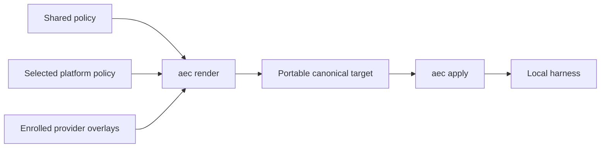
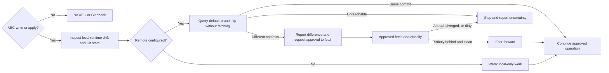
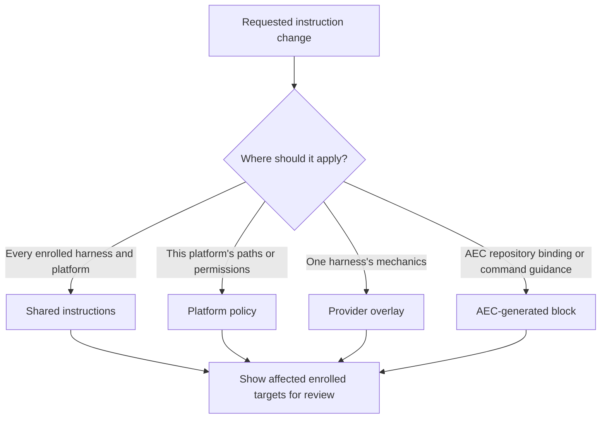
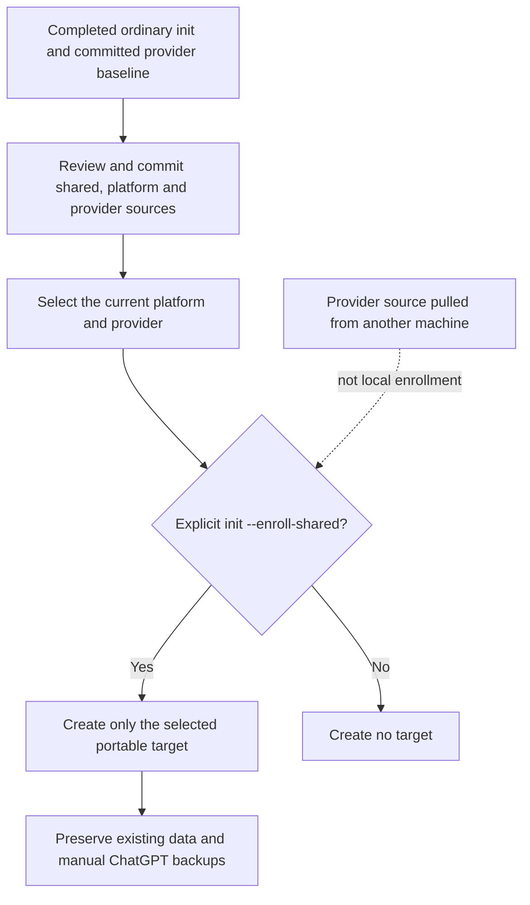
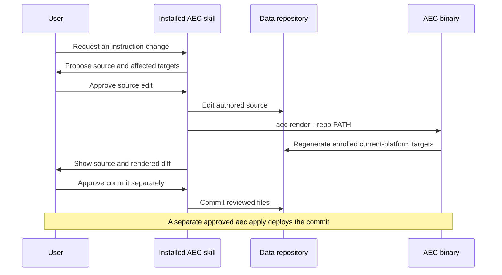
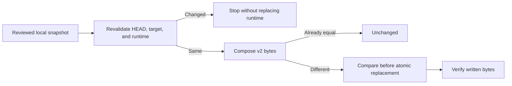
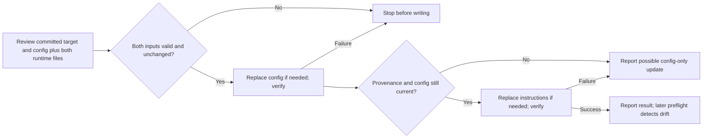
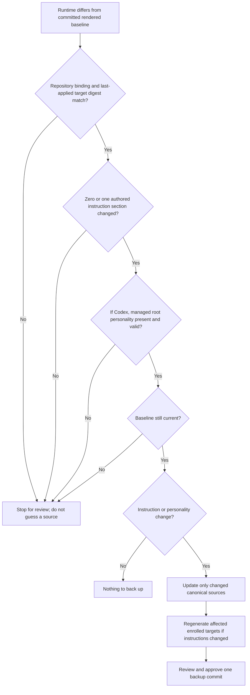
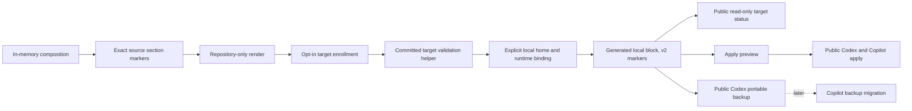

# Shared instructions — 2.0 development direction

Status: approved direction; implementation remains incremental on
`development/2.0`.



Git history remains the source of truth. `render` updates repository targets;
`apply` deploys the committed selected target to an initialized local harness.
Equivalent instructions across harnesses do not guarantee identical model
behaviour.

## Check only when AEC work is requested



`aec status` compares runtime with the local committed target only; it cannot
detect a commit pushed from another machine. Run local and remote preflight
immediately before an AEC-related canonical write or runtime apply, not on
unrelated chats or every approval reply. Skip local status for a new repository
without a baseline. A read-only remote-tip mismatch means only that commits
differ: local may be ahead, behind, or divergent. Fetch and any fast-forward
require approval; never use an automatic `git pull`. An absent remote permits
local-only work with a warning, while an unreachable configured remote leaves
freshness unknown and stops the operation. Pre-existing worktree changes that
could be mixed into the AEC operation require review. Manual runtime edits
made between AEC requests are detected on the next relevant check, provided
the managed control block remains intact and the harness follows it. No
per-conversation check or sidecar file lock is planned for this boundary.

## Choose the authored source



| Source | Contents | Owner |
|---|---|---|
| `environment/shared/instructions.md` | Collaboration, approval, engineering, learning, documentation, agile and architecture preferences; general parallel execution policy | User |
| `environment/platforms/<platform>/policy.md` | Explicitly approved local access roots and platform-specific personal rules | User |
| `environment/providers/<provider>/overlay.md` | Harness-specific execution preferences, including explicitly selected model mappings | User |
| AEC control block | Supported skill invocation, repository binding, canonical paths and directional command guidance | AEC |

Composition order is AEC block → shared → platform → provider. Later sections
cannot silently override shared approval or access restrictions.

For current Codex content, shared policy owns general personal rules; platform
policy owns the approved folder-access rule; the Codex overlay owns model mapping
and worker mechanics. Do not invent Copilot mappings or discard unclassified text.

## Lazy enrollment



The intended v2 macOS ARM64 Codex source set contains only:

```text
environment/
├── shared/instructions.md
├── platforms/macos-arm64/policy.md
└── providers/codex/overlay.md
```

The current opt-in requires these files to exist in a completed repository
and match committed `HEAD`. It does not create or classify them. Existing Codex
`AGENTS.md` remains in ordinary init's legacy lifecycle; managed
`config.toml` remains the canonical personality source;
initializing Copilot or another platform enrolls only the selected target.
CI coverage does not enroll anything in the user's data repository.

## Alignment workflow



Both installed skills use the same source decision; the binary validates and
renders it. `render` reports changed paths but never commits, applies, pushes,
or writes runtime. Explicit `apply` now deploys committed targets; public
`status` compares them with runtime. There is no
automatic `sync`.

The v2 target path is
`environment/targets/<platform>/<provider>/<instruction-file>`. It contains
portable authored sections. AEC's machine-specific repository binding and
command guidance belong in a generated local runtime block, not the portable
target. Existing `environment/providers/<provider>/<instruction-file>` files
remain in ordinary init and Copilot backup. Ordinary status and apply consume
committed rendered targets for both providers; Codex backup captures portable
authored sources.

`init --enroll-shared` now creates the selected target after validating the
three committed authored sources and the completed legacy AEC repository. It
does not edit runtime, stage, commit or push. `render` still treats existing
target directories as enrollment. A repository-only validator checks one
explicitly selected platform/provider target against the three committed
authored sources and rejects dirty working bytes. Public status and apply use
it without making repository writes. The read-only status helper requires an explicit
local provider home, checks any runtime instruction file's AEC repository
binding, and compares it byte-for-byte with the committed target plus the
generated local control block. A missing runtime instruction file reports
`missing`; a missing provider home or wrong binding stops. It never treats a
pulled target as proof that its harness is installed. Public `status` now uses
this check for both providers.

The 2.0 environment status combines that instruction comparison with Codex's
committed root `personality` value. A missing runtime config or root personality
is drift because apply can insert it; the public per-file line retains the
existing `missing` label. Unrelated config settings do not count as drift.
Copilot checks instructions
only. Missing runtime instructions report `missing`; invalid config or a wrong
repository binding stops with an error. Public `aec status` now uses its
per-file report without writing either side.

In-memory 2.0 local control blocks now name the committed target for the
selected platform and direct edits to the authored shared, platform, or
provider source before `render` and review. The latest stamped Codex blocks
use versions 9/10 (the latter retains manual ChatGPT backup guidance), and
Copilot uses version 3. The read-only helper also recognizes earlier portable
and supported 1.x blocks; a legacy block reports drift against the portable
target. Public apply now replaces it for both providers. The
public 1.x init generators remain unchanged. The portable target never stores
the machine-specific repository binding.

An internal apply preview now shares the same committed-target and local-binding
preflight as the read-only status helper. It builds the exact v2 instruction
bytes in memory, preserving Codex's ChatGPT-aware variant, and reports whether
the runtime would change. A missing runtime file, wrong repository binding, or
wrong v2 platform binding stops and directs the user to init; a pulled target
alone never authorizes a runtime write. The preview writes nothing and is not
a reusable authorization token: any future apply must revalidate immediately
before replacing runtime. Codex `config.toml` has a separate internal preview
included in the composite apply preview. Ordinary public Codex `apply` now
uses both previews; public Codex backup uses the reverse portable preflight.

The portable instruction writer is used by both guarded public apply paths:



An explicitly requested apply may replace runtime-only drift that was present
at review time; Git can recover committed canonical versions, not an
uncommitted runtime-only edit. The writer changes only the selected local
instruction file, never the data repository or Codex `config.toml`. Public
Copilot apply verifies the resulting runtime bytes after this writer returns.
The writer's final byte check rejects observed concurrent edits, but the
existing filesystem API cannot make comparison and rename a cross-process
atomic transaction; do not
claim protection against an edit in that last instant. The accepted policy is
to detect later drift at the next AEC-related preflight rather than add a
sidecar lock or claim protection from non-cooperating manual editors. Public
status and Codex backup now use the committed portable target; Copilot backup
remains a separate migration slice.

## Codex config preflight contract

The committed `environment/providers/codex/config.toml` remains the canonical
source for one managed root setting, `personality` (`none`, `friendly`, or
`pragmatic`). Runtime `~/.codex/config.toml` may contain unrelated settings;
the planned apply preserves them. This contract does not manage profile or
project overrides, or claim to determine Codex's effective personality.



| Preflight observation | Outcome |
|---|---|
| Canonical config missing, dirty, uncommitted, or invalid | Stop before either runtime write. Read it from the same HEAD as the portable instruction target; require exactly one supported root `personality` and no unmanaged canonical settings. |
| Runtime config absent or root `personality` absent | Warn and plan to insert the committed value. Do not invent a default during apply. |
| Runtime config ambiguous or invalid under the supported parser | Stop before either runtime write. |
| Reviewed runtime personality differs from committed value | This is expected apply drift; plan only the managed value change and preserve unrelated settings. |
| HEAD, target, canonical config, runtime instructions, or any runtime config bytes change after review | Stop before the first write. Recheck exact config bytes even when only an unrelated setting changed, so the planned replacement cannot erase it. |

Validate and plan both runtime files before writing either. Revalidate Git
provenance and both runtime snapshots immediately before the first replacement.
Write config first, then recheck provenance and the just-written config before
replacing instructions. Use the existing compare-before-replace and byte
verification for each file. If config replacement fails, leave instructions
untouched. If the second replacement fails or a recheck detects a change,
report which file may have changed; do not roll back automatically. Review
the partial state and retry only after another preflight. Each file is
individually guarded, not part of a two-file atomic transaction; the accepted
last-instant external-edit limitation above still applies. Public Codex
`apply` now uses this contract. Copilot `apply` uses only the instruction writer;
public `status` now uses the committed target and managed config preview;
Codex `backup` uses the reverse portable preflight. Copilot backup migration
remains separate.

Reverse mapping for Codex `backup` is deliberately narrower than free-form
instruction editing:



Exact AEC-owned delimiters distinguish shared, platform and provider text.
Marker collisions, generated-block edits, outside text, multi-section changes,
missing runtime personality, and stale baselines stop. The internal Codex
backup preflight now observes instruction attribution and managed root
personality against one repository HEAD without writing. A config-only change
is valid, and one instruction section plus personality may differ together.
The preview itself never writes. The separate internal Codex writer rechecks it
and refuses a staged index before replacing canonical config, then the optional
attributed instruction source and its affected targets. The renderer selects
all affected committed enrollments across supported platforms, regardless of
which harnesses are installed on the rendering machine. Public `aec render`
remains scoped to the current platform. The internal commit step rechecks the
exact changed paths and both runtime files, pins and verifies their Git tree,
and makes one commit. A failure after a replacement may leave earlier files
uncommitted; inspect before retrying. Public Codex `backup` calls this guarded
writer; it does not fetch or push.
The digest is SHA-256 of the rendered target bytes, excluding the local AEC
control block. The internal Codex and Copilot portable blocks record it, and
the read-only backup preview rejects missing or mismatched digests before
attributing a runtime edit. Older unstamped blocks remain readable for apply
migration, but cannot prove a fresh backup baseline. Public Codex `backup`
requires a stamped, current baseline; Copilot backup migration is separate.

## Direction and boundaries

- `status` inspects; `backup` captures runtime into the repository; `apply`
  deploys committed repository content. Preserve these separate directions.
- Shared-source changes should propagate through deterministic composition.
- Do not infer personal access permissions from installation paths.
- Do not treat provider directory presence as final proof of local harness
  enrollment: a pulled repository can contain providers used only elsewhere.
- A selected local provider home and supported runtime AEC binding establish
  the scope for an existing runtime file. An absent runtime file is `missing`,
  not evidence of activation; an absent home or wrong binding stops. Repository
  target presence alone never establishes local installation.
- Public Codex `status`, `backup`, and `apply` consume the enrolled committed
  target without falling back to the 1.x instruction source. Codex backup
  also captures the managed root personality. Copilot backup still awaits
  portable migration; this development branch is not release-ready yet.
- Platform policy is sufficient for the current single-machine case. Different
  machines on the same platform may need distinct access roots; defer their
  storage contract until required, rather than claiming platform equals machine.
- Keep CLI migration and multi-target `--all` semantics deferred until those
  contracts are reviewed. Previously illustrated command forms are proposals.

## Implemented foundation and next boundary



A small .NET BCL composition function accepts explicitly supplied shared,
platform, provider and generated-block content. Its preview is in memory and
does no enrollment, runtime write, commit or CLI migration. Focused xUnit tests
cover stable ordering, empty optional content, line endings and preservation of
personal text in disposable fixtures; the personal data repository is untouched.

The composition function uses two LF characters between nonempty sections,
independently of the operating system. All source characters, including trailing
newlines, CRLF, indentation and Unicode, remain unchanged. Empty sections are
omitted; whitespace-only content is retained. It adds no final newline. Optional
platform/provider text may be absent. The caller supplies the generated block;
this function neither validates that block nor interprets Markdown or resolves
policy conflicts. The repository-only render command now wraps authored sections
with exact markers and validates strict UTF-8. Copilot backup reverse mapping
remains a separate increment.

The approved rendered Codex/Copilot example confirms that shared approval and
access policy are retained while provider-only instructions stay scoped. The
internal validator checks a selected target's committed files and exact rendered
bytes without reading runtime. The internal status helper can compare that
target with a selected local runtime; supported legacy blocks report drift
against v2 output. The apply preview computes those same v2 bytes without
writing; an internal writer can replace only a reviewed, revalidated local
instruction file. Public Codex `apply` now uses the combined writer, and
Copilot `apply` uses the guarded instruction writer. Public `status` reads
the committed target; Codex `backup` now follows the guarded portable path,
while Copilot backup remains provider-specific. This is an intermediate
development-branch state, not a coherent release contract.
